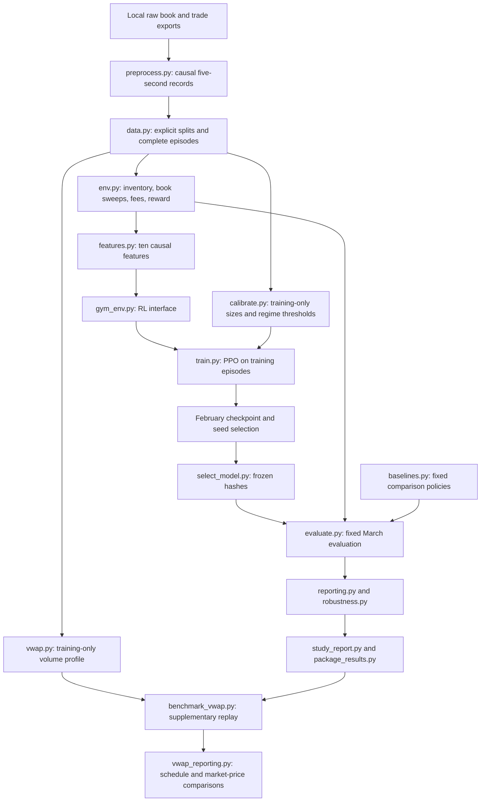

# AIDEN: a complete guide to execution research with reinforcement learning

AIDEN is a student research project that asks a specific question:

> Given a fixed amount of Bitcoin that must be sold over five minutes, can a learned execution policy choose a better selling schedule than simple rules?

The project uses **collected Binance BTCUSDT order books and trades**, simulates marketable sell orders, trains a PPO actor-critic, and compares its executions with immediate execution, TWAP, a liquidity rule, fixed timing controls, and a historical-volume VWAP schedule.

This README explains the financial problem, the code, the experiment, and the results from first principles. It is also a guide to reproducing and inspecting the work. You do not need prior reinforcement-learning experience, but basic Python and algebra will help.

**This is an independent student implementation inspired by the execution problem associated with RBC's AIDEN. It is not RBC software, an implementation of RBC's proprietary architecture, or an affiliated product.**

For a shorter route through the repository, use the [documentation map](docs/README.md). For development and Git hygiene, see [CONTRIBUTING.md](CONTRIBUTING.md).

## Contents

1. [The project in one page](#1-the-project-in-one-page)
2. [Trading concepts and units](#2-trading-concepts-and-units)
3. [Architecture and repository map](#3-architecture-and-repository-map)
4. [The actual data](#4-the-actual-data)
5. [How preprocessing works](#5-how-preprocessing-works)
6. [How rows become episodes](#6-how-rows-become-episodes)
7. [The execution environment](#7-the-execution-environment)
8. [Every agent action](#8-every-agent-action)
9. [Every observation feature](#9-every-observation-feature)
10. [Reward and accounting](#10-reward-and-accounting)
11. [The comparison strategies](#11-the-comparison-strategies)
12. [The neural networks and PPO training](#12-the-neural-networks-and-ppo-training)
13. [Experimental separation and model selection](#13-experimental-separation-and-model-selection)
14. [How evaluation is calculated](#14-how-evaluation-is-calculated)
15. [What the measured results mean](#15-what-the-measured-results-mean)
16. [Reading the saved artifacts](#16-reading-the-saved-artifacts)
17. [Installation and reproduction](#17-installation-and-reproduction)
18. [Tests, edge cases, and troubleshooting](#18-tests-edge-cases-and-troubleshooting)
19. [Limitations and the next defensible experiment](#19-limitations-and-the-next-defensible-experiment)
20. [Source-reading guide and references](#20-source-reading-guide-and-references)

If you want to run the code immediately, start with [installation](#17-installation-and-reproduction). If you want to assess the research claim, start with [the results](#15-what-the-measured-results-mean), then read the reward and evaluation sections before interpreting the numbers.

## 1. The project in one page

### What the system does

An episode begins with a parent obligation, such as **sell 0.7909 BTC**. The system gets 60 decision opportunities, five seconds apart. At each opportunity, the agent observes a compact description of the current market and its remaining obligation, then chooses how urgently to sell.

The execution engine walks the recorded bid prices from best to worst. It can sell only the quantity displayed in the 25 recorded bid levels. It deducts the configured fee and updates inventory and cash. At the last opportunity, it attempts to sell everything still remaining.

The learning task is **how to execute an existing sell decision**. It does not decide whether Bitcoin is a good investment, whether to open a long position, or whether a client should sell at all.

### What was actually completed

| Component | Recorded implementation |
|---|---|
| Market | Binance spot BTCUSDT |
| Inputs | Top-25 bid/ask snapshots and individual trades, then cleaned five-second records |
| Coverage | Seven separate days: the first day of each month from September 2020 through March 2021 |
| Episode | 60 decisions at offsets 0, 5, …, 295 seconds |
| Agent actions | Wait, below schedule, on schedule, above schedule |
| Actor input | Ten causal features, fixed order and fixed scaling |
| Learner | Stable-Baselines3 PPO, with separate two-layer 64-unit actor and critic networks |
| Training | Three seeds, 200,704 interactions each; **602,112 total** |
| Primary order | 0.7909 BTC; smaller/larger transfer tests at 0.07909 and 3.954 BTC |
| Cost scenario | Assumed 10-bp fee; fixed-fill sensitivity at 0, 10, and 20 bps |
| Selection | February validation chooses seed 19 before March policy evaluation |
| Test data | All 287 complete March episodes |
| Verification | 128 implementation tests passed with no skips in the recorded full environment |
| Deliverables | Source, tests, checkpoints, logs, per-episode CSVs, plots, configuration, and integrity manifests |

### The main finding

At the primary order size on March 1:

| Policy | Mean net arrival cost, bps | Completed orders |
|---|---:|---:|
| Selected PPO | **7.126** | 287 / 287 |
| TWAP | 7.504 | 287 / 287 |
| Historical-profile VWAP | 7.531 | 287 / 287 |
| Immediate execution | 10.670 | 287 / 287 |

PPO's average cost was modestly lower on this day. Its tail costs were worse, and it failed to complete seven of the 287 large orders. On February validation, both the fixed above-schedule control and the subsequently added VWAP schedule had better primary-size mean costs than the selected PPO.

**The supported conclusion is a mixed historical-replay result.** The work demonstrates a functioning research pipeline and a measured comparison. It does not establish a consistently superior execution algorithm or live profitability.

The full numerical records are the local original study, `artifacts/RESULTS.md`, and VWAP supplement, `artifacts/vwap/REPORT.md`. The current Git configuration excludes `artifacts/`; Section 15 preserves the main findings in this README, while Section 16 explains the optional local result bundle.

## 2. Trading concepts and units

### 2.1 Parent orders, child orders, and inventory

A **parent order** is the total obligation: sell a specified amount by a deadline. A **child order** is one attempt to execute part of it.

For a parent of 0.7909 BTC:

- Selling 0.01 BTC is one child execution.
- Selling another 0.02 BTC brings total filled quantity to 0.03 BTC.
- Remaining inventory is 0.7609 BTC.
- Completion means the entire parent was filled, not merely that the episode stopped.

The code never buys, increases the parent obligation, or sells more BTC than remains.

### 2.2 What an order book contains

A **bid** is a displayed price at which someone is willing to buy. An **ask** is a displayed price at which someone is willing to sell.

A marketable seller trades against **bids**. The highest bid is the best available selling price. If there is insufficient quantity there, the seller continues to lower bids.

An illustrative book might contain:

| Bid level | Price, USDT/BTC | Displayed amount, BTC |
|---|---:|---:|
| 0 | 100 | 0.4 |
| 1 | 99 | 0.7 |
| 2 | 98 | 0.5 |

Selling 0.9 BTC receives:

```text
0.4 × 100 + 0.5 × 99 = 89.5 USDT
```

Selling 2 BTC against only that displayed liquidity fills 1.6 BTC, receives 158.3 USDT, and leaves 0.4 BTC unfilled. The simulator does not invent deeper bids.

These small prices make the arithmetic readable. They are illustrative examples, not the historical BTC prices used in the experiments.

### 2.3 Midprice and spread

If the best bid is 100 and the best ask is 102:

```text
midprice = (100 + 102) / 2 = 101
spread = 102 - 100 = 2
```

The midprice is a reference between the two quotes. A seller is not guaranteed a fill there. Even an immediate, tiny marketable sell normally receives the bid, below the midpoint.

The **arrival midprice** is the midpoint when the parent starts. It stays fixed as the execution-cost reference for that parent.

### 2.4 Basis points

One basis point, or **1 bp**, is 0.01%, which is 0.0001 as a fraction. Therefore:

```text
10 bps = 0.1% = 0.001
fee on 1,000 USDT at 10 bps = 1 USDT
```

Basis points allow costs to be compared across different BTC prices and order notionals. The experiment's cost means average episode-level basis-point costs; they are not a dollar-weighted portfolio return.

### 2.5 Gross cash, net cash, and notional

- **Gross cash:** USDT received from the book sweep before fees.
- **Fees:** the configured proportion of executed gross notional.
- **Net cash:** gross cash minus fees.
- **Parent arrival notional:** parent BTC quantity multiplied by arrival midprice.
- **Residual inventory:** BTC still unsold.

USDT is the quote currency used by this dataset. The code does not simulate conversion between USDT and USD or a change in their exchange rate.

### 2.6 Slippage, implementation shortfall, and market impact

**Implementation shortfall** compares execution with a specified reference price. For a completed sell, receiving a lower average price than the arrival midpoint produces positive cost. Receiving a higher price produces negative cost.

A negative cost can result from favorable market movement while the order waits. It is not automatically trading profit: the project begins with an obligation to sell an existing asset and does not account for acquiring it.

**Walking the book** captures the worse prices obtained when one child order exhausts better displayed bids.

**Endogenous market impact** means our order changes later market prices or liquidity. That is not modeled. The next historical snapshot is unchanged by our previous trade. This distinction matters especially for large orders.

### 2.7 TWAP and the two meanings of VWAP

**TWAP execution** spreads quantity across time. This project uses adaptive remaining-time TWAP: remaining BTC divided by remaining opportunities.

**Market VWAP** is a price: total market trade notional divided by total market trade volume during an interval.

**A VWAP execution strategy** is a sequence of trades intended to follow expected market activity. A feasible strategy must act before knowing the future interval's final volume. The implementation therefore uses a training-only historical volume profile.

Outperforming an executable VWAP schedule does not mean selling above the realized market-VWAP price. This project measures both.

## 3. Architecture and repository map

### 3.1 The end-to-end flow



The arrows describe responsibilities. Data integrity checks may read complete stored episodes, but the policy's feature computation uses only the current and past observations. The stored episode is not a security boundary; custom policy code could deliberately access future rows. The provided policies do not do that.

### 3.2 Why the code is divided this way

The replay engine is separate from the learning library so that accounting can be tested without training a neural network. The same engine executes the hand-written baselines, the learned policy, and VWAP.

Feature computation is separate because the meaning and order of model inputs must remain stable. Evaluation is separate from training so a reporting command cannot silently optimize the model it is meant to measure. Selection is separate so the chosen checkpoint and its evidence can be recorded before final testing.

The modules remain at the project root because this is a small research repository. There is no additional service layer, exchange connector, database, or distributed training system.

### 3.3 Every top-level Python module

| File | Main responsibility | Important interface or output |
|---|---|---|
| [preprocess.py](preprocess.py) | Sample books and aggregate trades in chunks | `sample_book`, `aggregate_trades`, `process_day` |
| [data.py](data.py) | Parse cleaned rows and yield complete, date-checked episodes | `load_episodes`, `load_split`, `LoadStats` |
| [env.py](env.py) | Validate books, compile actions, sweep bids, account for orders | `SellExecutionEnv`, `execute_sell`, `compile_action` |
| [features.py](features.py) | Build causal features and the fixed model vector | `FEATURE_NAMES`, `build_observation`, `observation_vector` |
| [gym_env.py](gym_env.py) | Adapt the replay core to Gymnasium | `GymSellExecutionEnv.reset/step` |
| [baselines.py](baselines.py) | Five fixed schedules and timing controls | `baseline_request`, `BASELINE_NAMES` |
| [calibrate.py](calibrate.py) | Derive size and descriptive regime cutoffs from training | `calibrate`, `episode_market_context` |
| [train.py](train.py) | Configure, fit, validate, and save each PPO seed | `train_seed`, manifests, checkpoints, CSV logs |
| [select_model.py](select_model.py) | Select a PPO seed using full validation | `choose_model`, `freeze_selection` |
| [evaluate.py](evaluate.py) | Replay policies on exactly matched obligations | `evaluate_episode`, `evaluate_episodes` |
| [reporting.py](reporting.py) | Pair results, calculate descriptive statistics, draw figures | `paired_results`, `summarize_results` |
| [robustness.py](robustness.py) | Reprice saved fills and describe hourly variation | `reprice_fees`, `hourly_comparisons` |
| [study_report.py](study_report.py) | Assemble the original study's measured report | `build_report`, learning curves |
| [run_experiment.py](run_experiment.py) | Orchestrate the ordered research workflow | Training → validation → freeze → diagnostics → test → report |
| [package_results.py](package_results.py) | Copy a completed study after integrity checks | Portable bundle and SHA-256 manifest |
| [vwap.py](vwap.py) | Historical-volume schedule and ex-post market VWAP | `fit_volume_profile`, `vwap_request`, `market_vwap` |
| [benchmark_vwap.py](benchmark_vwap.py) | Add VWAP to the frozen original comparison | Verify archived records, replay only the added strategy |
| [vwap_reporting.py](vwap_reporting.py) | Summarize VWAP schedules and price slippage separately | Exact pairs, completion counts, cost plots |
| [smoke_env.py](smoke_env.py) | Exercise action wiring on the first training episode | A diagnostic only, never research-performance evidence |

The detailed behavior of these interfaces is explained below; the table is a navigation map rather than a substitute for their contracts.

### 3.4 Directories and supporting files

| Location | What belongs there |
|---|---|
| [configs/experiment.json](configs/experiment.json) | Order sizes, seeds, fees, training statistics, regime thresholds, and training-input hashes |
| [tests/](tests/) | Small controlled examples and regression tests; individual files are mapped in Section 18 |
| [docs/](docs/README.md) | Navigation index and focused environment, data, experiment, verification, and VWAP records |
| `artifacts/` | Local original study: checkpoints, logs, CSVs, figures, reports, and manifest; currently excluded from Git |
| `artifacts/vwap/` | Local, separately recorded supplementary VWAP comparison |
| `data/` | Local raw and cleaned market data; excluded from Git |
| `runs/` | Working experiment output; excluded from Git |
| `.local/archive/dataprocess.ipynb` | Original exploratory notebook, preserved unchanged locally; its saved market output is excluded from Git |
| [CONTRIBUTING.md](CONTRIBUTING.md) | Development, validation, research-provenance, and commit workflow |
| [requirements.txt](requirements.txt) | Exact full-stack versions used for the recorded research |
| [requirements-env.txt](requirements-env.txt) | Smaller NumPy/Gymnasium dependency set |
| [.github/workflows/tests.yml](.github/workflows/tests.yml) | Install full dependencies and run the implementation test suite |
| [.gitignore](.gitignore) | Exclude market inputs, caches, local environments, credentials files, working runs, and local artifacts |
| [.gitattributes](.gitattributes) and [.editorconfig](.editorconfig) | Text line-ending and editor conventions; no source reformatting is required |

The notebook is archival and remains only in the ignored local archive. The portable supported preprocessing entry point is `preprocess.py`; the notebook still contains a trailing call to an undefined `main()`, and its saved outputs are not a guarantee that its current cells execute successfully in sequence. Its code and historical outputs were preserved unchanged during repository cleanup.

## 4. The actual data

### 4.1 Provider, venue, instrument, and granularity

The local inputs are Tardis-format exports of Binance spot **BTCUSDT**:

- **`book_snapshot_25`:** reconstructed snapshots containing up to the first 25 price levels on each side.
- **`trades`:** individual trades with price, amount, side, and timestamps.

Tardis distinguishes the exchange timestamp from `local_timestamp`, the message receipt time. Its CSV timestamp units are UTC microseconds since the Unix epoch. The code uses receipt time when deciding what could have been known by a decision. See the [provider's schema](https://docs.tardis.dev/downloadable-csv-files/data-types) and [data conventions](https://docs.tardis.dev/faq/data).

The repository consumes files already collected locally. It does not contain a market-data downloader, provider credentials, or a promise that another download will have identical bytes. Input hashes identify the specific files used.

An L2 snapshot aggregates quantity by price. It does not identify every individual resting order or the agent's position in a queue. The supplied snapshots are already reconstructed; this repository does not rebuild an exchange book from incremental L2 messages.

### 4.2 Seven days, not seven months of observations

| Split | Day | Label | Cleaned rows | Complete episodes | Rows excluded from complete episodes |
|---|---|---|---:|---:|---:|
| Training | 2020-09-01 | Sep2020 | 17,279 | 287 | 59 |
| Training | 2020-10-01 | Oct2020 | 17,279 | 287 | 59 |
| Training | 2020-11-01 | Nov2020 | 17,278 | 287 | 58 |
| Training | 2020-12-01 | Dec2020 | 16,724 | 276 | 164 |
| Training | 2021-01-01 | Jan2021 | 17,279 | 287 | 59 |
| Validation | 2021-02-01 | Feb2021 | 17,273 | 285 | 173 |
| Testing | 2021-03-01 | Mar2021 | 17,279 | 287 | 59 |
| **Total** | **7 isolated days** | | **120,391** | **1,996** | **631** |

Each valid episode contains exactly 60 decisions. Thus the original training pool contains **1,424 × 60 = 85,440 decision rows**, while its cleaned source files contain 85,839 rows before incomplete windows are dropped.

A gap of a month between files is not filled with invented data. Episode sampling during training chooses among the actual complete windows; it does not simulate continuous trading between these dates.

### 4.3 Local filenames

For September:

```text
data/training/Sep2020_T25.gz       # raw book snapshots
data/training/Sep2020_Trade.gz     # raw trades
data/training/Sep2020_5s.csv.gz    # cleaned decision records
```

The same pattern applies to all seven labels under their respective split directories. The loader's fixed `SPLIT_DAYS` mapping and expected-date checks prevent a file merely renamed “training” from silently importing March observations.

### 4.4 Raw schema

A raw book row has 104 columns: exchange, symbol, exchange timestamp, local receipt timestamp, and 100 numeric book fields:

```text
2 sides × 25 levels × (price, amount) = 100 book values
```

A raw trade row includes exchange, symbol, timestamp, local timestamp, trade identifier, side, price, and amount. Preprocessing selects the fields required for aggregation.

If exchange and local timestamps happen to match in an export, that does not establish zero market-data latency. Provider timestamp conventions can include a fallback. In this project, “causal” means causal relative to the recorded receipt timeline.

### 4.5 Cleaned schema

Every current cleaned file contains the same **110 columns**:

| Field family | Columns | Meaning |
|---|---:|---|
| `decision_time` | 1 | UTC time when a strategy may act |
| `book_local_timestamp` | 1 | Receipt time of the snapshot selected for that decision |
| `bids[i].price`, `bids[i].amount` | 50 | USDT/BTC price and BTC quantity for bid levels 0–24 |
| `asks[i].price`, `asks[i].amount` | 50 | Equivalent ask fields |
| `trade_count_5s` | 1 | Number of received trades in the five-second bin |
| `trade_volume_btc_5s` | 1 | Sum of trade BTC amounts |
| `trade_notional_usdt_5s` | 1 | Sum of price × BTC amount |
| `signed_trade_volume_btc_5s` | 1 | Buy volume minus sell volume; unknown-side volume contributes zero sign |
| `trade_vwap_5s` | 1 | Bin notional / volume, missing when volume is zero |
| `book_age_ms` | 1 | Decision time minus selected receipt time, in milliseconds |
| `mid_price` | 1 | Midpoint of the best recorded bid and ask |
| `spread` | 1 | Best ask minus best bid |

The raw book export interleaves bid and ask fields by level; preprocessing constructs a normalized field order. Consumers address columns by name rather than depending on raw positional order.

The five-second VWAP column is not an agent input. In the supplementary benchmark, market VWAP is reconstructed from summed notionals and volumes rather than an unweighted mean of these bin prices.

### 4.6 What the existing data audit established

The [data audit](docs/data_checks.md) checked every processed row, including rows later excluded from episodes. It found valid ordered books, UTC decision grids, no crossed best quotes, consistent book ages, and finite amounts/prices. It also compared stored midpoint, spread, and book age with recomputed values.

Those checks validate formatting and internal consistency. They do not prove that every raw exchange event was collected, reconstruct every historical trade aggregation independently, or establish that our hypothetical order would actually have received the modeled fills.

One earlier claim that the September raw book contained 5,206,603 rows is unsupported by the current file. The verified file contains **751,701 data rows**, excluding its header. Its path, compressed byte count, and SHA-256 are recorded in the data audit. Use the verified count rather than repeating an untraceable dataset statistic.

## 5. How preprocessing works

The executable pipeline is [preprocess.py](preprocess.py). The notebook is an exploratory predecessor; it is not the reproducible entry point.

### 5.1 Construct a clock before looking at outcomes

For each UTC day, preprocessing creates 17,280 candidate decisions:

```text
00:00:00, 00:00:05, 00:00:10, …, 23:59:55
```

The grid is fixed independently of prices, trades, strategy choices, or profitability. Missing or stale books remove a decision; corrupt depth or other invalid input raises an error. The pipeline never compresses time to hide a gap.

### 5.2 Select the last available book

For a decision at time `t`, use the most recent snapshot with:

```text
book_local_timestamp <= t
```

This is an as-of lookup. Choosing the nearest snapshot in either direction would sometimes select a future book. Linear interpolation would create prices and quantities that were never jointly observed. Neither is used.

Raw gzip files are read in chunks of 100,000 rows. Receipt timestamps must be nondecreasing within and between chunks. NumPy `searchsorted(..., side="right") - 1` locates the final eligible row. A carry row preserves the last snapshot across chunk boundaries. Decisions at the final timestamp of a chunk are deferred so duplicate timestamps in the next chunk can still be resolved to the last recorded row.

Book fields occupy a fixed NumPy array; timestamp selection preserves integer microseconds. Missing timestamp sentinels become `NaT` without first passing valid epoch values through floating-point conversion. The representation preserves the timestamp precision used by the causality checks.

### 5.3 Aggregate only trades already received

For a decision at `t`, the trade bin is:

```text
(t - 5 seconds, t]
```

A trade received exactly at `t` belongs to this bin. A trade received just after `t` belongs to a later decision. A trade exactly at `t - 5` belongs to the preceding bin.

The implementation maps integer receipt timestamps to bins using a ceiling division, then uses `numpy.bincount` to accumulate:

```text
count             = number of trades
volume            = sum(amount)
notional          = sum(price * amount)
signed_volume     = sum(side_sign * amount)
trade_vwap        = notional / volume, if volume > 0
```

The signs are `+1` for a buy, `-1` for a sell, and `0` for an explicitly unknown side. Unknown-side trades still contribute count, volume, and notional. Other side labels are rejected. Trade prices and amounts must be finite and strictly positive.

The last grid point is 23:59:55. Trades after it do not become an extra midnight decision. The first bin cannot borrow trades from an unavailable previous-day file. In these inputs the first five-minute window also lacks a valid midnight book, so it is dropped when episodes are constructed.

### 5.4 Reject invalid decisions

For selected, time-valid decision rows, the preprocessor checks all 25 levels on both sides. Prices must be finite and positive; amounts must be finite and nonnegative. Bids strictly decrease, asks strictly increase, and the best bid must be below the best ask. This does not constitute a full-depth audit of every unselected raw snapshot or a stale row already excluded by the time filter.

A selected book cannot come from the future. Missing books and books older than five seconds are excluded. Exactly five seconds is allowed. The code rejects duplicate decision timestamps and computes midpoint, spread, and age. The separate historical data audit checked those derived relationships independently.

Zero displayed amount is allowed at a level; it contributes no executable quantity. Equal-price entries are not treated as separate valid levels. These rules assume an already aggregated L2 book.

### 5.5 What preprocessing assumes

The raw paths must identify the intended venue, instrument, and day. The current raw files were inspected as Binance BTCUSDT, but the preprocessor does not independently enforce every raw exchange/symbol field. It also expects integer-microsecond raw timestamps; its integer conversion is not a general validator for fractional timestamp inputs.

Those assumptions are separate from the stricter cleaned-data loader. Do not interpret “validated” as a guarantee for every possible malformed third-party export.

## 6. How rows become episodes

### 6.1 Loader responsibilities

[data.py](data.py) reads the cleaned gzip CSVs, parses numeric fields and UTC timestamps, and groups rows by UTC five-minute boundary. `load_split` enforces the fixed split/day mapping. The lower-level `load_episodes` enforces an expected date when its caller supplies `expected_date`; it is not independently a split-aware API.

An episode must contain exactly:

```text
t0, t0 + 5, t0 + 10, …, t0 + 295 seconds
```

where `t0` lies on a five-minute boundary. A missing middle row invalidates the whole window. Rows from two windows are never joined to manufacture 60 observations. Duplicate, out-of-order, off-grid, wrong-date, future-receipt, or stale rows are errors rather than silently repaired observations.

The parser rejects naive timestamps and nonzero UTC offsets. It also rejects unsupported sub-microsecond precision rather than truncating a receipt from just after a decision onto that decision. CSV errors include path/row context where available. Missing `trade_vwap_5s` is legitimate for a zero-volume bin; required execution and observation fields cannot be missing.

### 6.2 Data structures

The loader yields each episode as a Python list of row dictionaries; there is no custom `Episode` class. Its date and start time come from the first row's `decision_time`, while the chosen loader supplies the split context. Evaluation constructs an episode identifier from that timestamp. The environment separately normalizes and validates the rows into a tuple of read-only mappings. The neural network receives a feature vector, not the full list of rows.

Loader statistics distinguish complete episodes, observed incomplete windows, and discarded rows. An entirely absent five-minute window has no rows to group, so it is not counted as an observed incomplete window. December has seven observed partial windows and five entirely absent windows, alongside its 276 complete episodes. Counters finalize as the iterator is consumed; stopping after the first yielded episode does not produce full-file statistics.

### 6.3 Parent sizes are calibrated only on training data

[calibrate.py](calibrate.py) computes total 25-level bid depth for the 85,440 rows belonging to complete training episodes. The median is **7.9085725 BTC**. Parent sizes are fixed fractions of that median, rounded to four significant digits:

| Label | Fraction of training median depth | Parent BTC |
|---|---:|---:|
| Small | 1% | 0.07909 |
| Medium, the training and selection size | 10% | 0.7909 |
| Large | 50% | 3.954 |

The quantity stays fixed across episodes of the same size. It does not adapt to future episode liquidity or future traded volume. The rule gives the sizes an empirical scale, but it is not a participation constraint or an estimate of safe live capacity.

Training also sets descriptive spread and volatility regime cutoffs at the one-third and two-thirds quantiles. These thresholds are frozen before validation/testing. Whole-episode volatility is used only after an episode for analysis; the actor receives a trailing volatility feature instead.

The resulting [experiment configuration](configs/experiment.json) stores sizes, splits, fees, seeds, thresholds, and training-file hashes. Calibration writes a new timestamp and can overwrite its output path. Preserve the supplied configuration when reproducing the saved study; recalibrate into a new file for a new experiment.

## 7. The execution environment

### 7.1 Separate economic accounting from the RL interface

The core class, `SellExecutionEnv` in [env.py](env.py), does not need PyTorch, Gymnasium, or Stable-Baselines3. It owns inventory, cash, fees, timing, fills, and rewards. Fixed strategies and PPO use the same execution accounting.

`GymSellExecutionEnv` in [gym_env.py](gym_env.py) translates that core into the standard interface required by the learner:

```python
observation, info = gym_env.reset(seed=19)
observation, reward, terminated, truncated, info = gym_env.step(action_id)
```

The separation keeps an error in policy training from changing what a BTC fill means.

### 7.2 Core lifecycle

```text
Construct with one valid episode, Q, and fee
    -> reset: inventory Q, cash 0, step 0
    -> observe current row and past rows
    -> compile action or accept a direct BTC request
    -> execute against this row's bids
    -> charge fee, update inventory/cash, record result
    -> advance one decision
    -> repeat until inventory is zero or all 60 decisions are consumed
    -> produce terminal summary
```

`reset()` restores the original obligation and clears previous execution history. `current_book` exposes the current immutable row while the episode is active. `step_action(action)` takes one of the four agent actions. `step(requested_btc)` supports quantity-based benchmark policies through the same accounting path.

The direct quantity interface is not a fifth neural action. It lets TWAP or a volume schedule express an exact quantity without rounding it into one of four urgency choices.

Calling `step` after termination, requesting a terminal summary before termination, or reading a current executable book after the episode has ended raises an error. An invalid request is rejected before the normal state update.

### 7.3 The book-row mapping

A book row is a mapping from column names to values, not a list of `Bid` objects:

```python
price = book_row["bids[0].price"]
amount = book_row["bids[0].amount"]
```

The core requires 100 book values, two timestamps, total trailing trade volume, and signed trailing trade volume: **104 required fields**. It retains additional cleaned columns without requiring the actor to use them.

Validated row dictionaries are copied and wrapped in `MappingProxyType`, then stored in a tuple. This prevents normal in-place changes to the recorded market scalars. The overall Python object and its history remain mutable research interfaces; unused nested extra objects are not recursively frozen.

### 7.4 How `execute_sell` fills an order

The helper returns:

```python
(filled_btc, received_usdt, unfilled_btc)
```

It validates the request and all 25 bid levels, then visits bids from highest to lowest. At each level:

```text
fill_here = min(quantity_still_requested, displayed_amount)
cash_here = fill_here * bid_price
```

It stops when the request is filled or recorded depth is exhausted. Zero-size levels contribute nothing. It uses `math.fsum` for accumulated quantities and cash to reduce avoidable floating-point summation error. It returns gross proceeds; the environment applies fees.

There is no fill beyond recorded level 24, extrapolated price, or assumed infinite final-level liquidity. A request larger than available depth returns a positive unfilled quantity.

The helper leaves the supplied row unchanged. Within one decision, the request cannot reuse a consumed level. At the next decision, a new historical snapshot is used, with no counterfactual subtraction of our previous executions. That replay assumption becomes less credible as the simulated order grows.

The traversal is small because depth is fixed at 25. The implementation repeatedly sums fill prefixes, so it should not be advertised as a strictly linear algorithm for arbitrarily large books. Likewise, cumulative accounting re-sums a history of at most 60 steps. Readability and auditability take priority over exchange-scale throughput here.

### 7.5 Partial fills and remaining obligations

Suppose 0.8 BTC remains, a strategy requests 0.3 BTC, and only 0.1 BTC can fill. The new remaining obligation is 0.7 BTC:

```text
new_remaining = old_remaining - submitted + unfilled
              = 0.8 - 0.3 + 0.2
              = 0.7 BTC
```

The unfilled child request does not become a resting order or a hidden retry queue. On the next decision the strategy chooses again using the remaining parent inventory. A TWAP-like strategy naturally catches up because its next scheduled slice is recomputed.

Requests are capped at remaining parent inventory. A strategy cannot oversell the parent. A direct request's original quantity can be retained in diagnostics even when the submitted quantity is capped.

### 7.6 Terminal behavior

At decision 59, the default environment raises a smaller request to all remaining inventory. It still respects available depth. Therefore:

```text
done       = inventory exhausted OR decision horizon exhausted
completed  = inventory exhausted
```

`done=True` does not imply `completed=True`.

The diagnostic `forced_terminal_liquidation` means the terminal rule **increased the requested quantity**. It is false if the strategy already requested all remaining inventory. It does not mean all inventory successfully liquidated, nor does a false value imply no final-step execution.

The last scheduled execution opportunity is at **295 seconds**; a completed order can finish earlier. The `time_remaining_seconds` diagnostic counts remaining scheduled opportunities: it begins at 300 seconds, reads 5 seconds before the final action, and becomes zero at termination. The actor's corresponding fraction starts at 1. There is no extra liquidation quote at 300 seconds.

### 7.7 What each step records

`StepResult` is an immutable dataclass. Its fields make the decision auditable:

| Fields | Interpretation |
|---|---|
| `step_index`, `decision_time`, `action` | Which decision ran; `action` is `None` for a direct quantity request |
| `strategy_requested_btc`, `submitted_btc` | Strategy request entering the common executor, already capped for discrete actions, and request after parent/terminal handling |
| `filled_btc`, `unfilled_btc`, `remaining_btc` | Actual child fill, unfilled submitted amount, remaining parent |
| `received_usdt`, `fee_usdt`, `net_received_usdt` | Gross cash, fee, and net cash for this step |
| `cumulative_filled_btc`, `cumulative_received_usdt` | Parent-to-date filled quantity and gross cash |
| `forced_terminal_liquidation`, `done` | Terminal override diagnostic and lifecycle state |
| `execution_reward_bps`, `residual_penalty_bps`, `reward` | Execution component, terminal inventory penalty, and combined reward |

### 7.8 Gym sampling and termination

The Gym adapter holds a pool of episodes. Each reset samples uniformly with replacement using its seeded random generator. `options={"episode_index": i}` instead chooses a specific episode for deterministic evaluation. Indices must be valid integers; invalid options or actions are rejected.

Observations become finite `numpy.float32` arrays. The action space is `Discrete(4)`. The observation space encodes bounded fractions/imbalances and permits unbounded positive or signed market features where appropriate. It does not clip unusual observations into a normal range.

A finished parent or exhausted deadline returns `terminated=True, truncated=False`. The deadline is part of the execution task itself, not an unrelated external time limit. The terminal observation reflects the last consumed market row and actual remaining inventory; incomplete inventory is not rewritten to zero.

Reset information identifies the episode, quantity, arrival price, and fee. Step information includes the execution record and, when finished, the summary. Calling Gym `step` before `reset` is an error.

## 8. Every agent action

### 8.1 Recompute the remaining schedule

Before decision `i`, let:

```text
R = remaining BTC
n = 60 - i                   # includes the current opportunity
s = R / n                    # current on-schedule slice
```

`Action` is an `IntEnum`; its stable IDs are also PPO's categorical output IDs:

| ID | Name | Strategy request | Why it exists |
|---:|---|---|---|
| 0 | `WAIT` | `0` | Allow deferral when current conditions seem unattractive |
| 1 | `BELOW_SCHEDULE` | `0.5 * s` | Sell while preserving more inventory for later |
| 2 | `ON_SCHEDULE` | `s` | Track the equal-slice remaining schedule |
| 3 | `ABOVE_SCHEDULE` | `min(R, 2 * s)` | Accelerate when urgency or market conditions warrant it |

Every action uses the same book-walking fill algorithm. These are urgency choices, not four exchange order types.

For `R = 0.6 BTC` and `n = 30`, the requests are `0`, `0.01`, `0.02`, and `0.04 BTC`. If only `0.005 BTC` is displayed, any positive request can fill at most `0.005 BTC` at that decision.

### 8.2 Compilation makes the action inspectable

`compile_action` returns an `ActionRequest` containing:

| Field | Meaning |
|---|---|
| `action` | Validated enum |
| `schedule_btc` | `R / n` |
| `strategy_requested_btc` | Quantity chosen by the action, capped at the parent |
| `submitted_btc` | Quantity after the final-step override |
| `available_bid_depth_btc` | Sum of the 25 displayed bid amounts |
| `executable_btc` | `min(submitted_btc, available_bid_depth_btc)` |
| `forced_terminal_liquidation` | Whether the final rule increased the request |

This structure separates intention from submission and execution. It is useful for debugging an apparently small fill: the policy may have requested little, or the market may simply have lacked recorded depth.

On the final decision, `n=1`. On-schedule and above-schedule already request `R`, while wait and below-schedule require an override. All four then submit the same remaining amount under the default terminal rule. Their earlier trajectories still differ.

### 8.3 Why there are no cancel/join/improve actions

An earlier design explored a synthetic buy-side system with six order-management actions. The implemented research scope follows the later sell-side snapshot-replay design with four urgency actions, as explained in [the environment design notes](docs/environment.md).

Adding `CANCEL`, `JOIN`, or `IMPROVE` as aliases would be misleading: this simulator has no resting orders, queue state, or passive-fill model for those actions to operate on. They require a different market simulator and richer execution assumptions. The current action set deliberately describes operations the recorded data and accounting model can support.

## 9. Every observation feature

### 9.1 What the actor sees

The core observation dictionary contains **13 named values**. Three are additional readable diagnostics: `inventory_remaining_btc`, `time_remaining_seconds`, and `midprice_return_from_arrival_bps`.

PPO receives only the following **ten features**, in `FEATURE_NAMES` order. Changing their order or meaning invalidates a saved policy's input contract.

Let `Q` be the original parent quantity, `R` the remaining quantity, `m` the current midpoint, `b/a` the best bid/ask, `B/A` total 25-level bid/ask depth, and `bq/aq` the best bid/ask amounts.

| Position | Name | Value before model scaling | Purpose |
|---:|---|---|---|
| 0 | `inventory_remaining_fraction` | `R / Q` | Remaining obligation |
| 1 | `time_remaining_fraction` | Remaining decision opportunities / 60 | Deadline urgency |
| 2 | `spread_bps` | `10000 * (a - b) / m` | Current quoted crossing cost |
| 3 | `depth_imbalance` | `(B - A) / (B + A)`, or 0 if both vanish | Relative displayed buying/selling depth |
| 4 | `relative_bid_depth` | `log(1 + B / Q)` | Available displayed bids relative to our order |
| 5 | `weighted_mid_deviation_bps` | `10000 * (weighted_mid - m) / m` | Best-level size pressure proxy |
| 6 | `recent_mid_return_bps` | `10000 * log(m[i] / m[i-1])`, initially 0 | Most recent price move |
| 7 | `trailing_volatility_bps` | `10000 * sqrt(sum(recent log_return²))`, initially 0 | Recent price variability |
| 8 | `recent_trade_volume` | `log(1 + trailing_5s_volume / Q)` | Recent activity relative to parent size |
| 9 | `signed_trade_flow` | Signed trailing volume / total trailing volume, or 0 | Direction of recent aggressor flow |

The weighted midpoint is:

```text
weighted_mid = (a * bq + b * aq) / (bq + aq)
```

If both best-level amounts are zero, it falls back to the ordinary midpoint. The opposite-side weights move the proxy toward the ask when bid size is relatively large. This is a simple quote-size proxy, not a fitted multi-state microprice estimator.

Trailing volatility uses at most the last 12 adjacent returns, including the current observed return, within the episode. It is a root sum of squared log returns. It is not a demeaned standard deviation and is not annualized. There is no pre-episode warm-up history.

### 9.2 Fixed scaling

Before building the model vector, the four basis-point features—spread, weighted-mid deviation, recent return, and trailing volatility—are divided by 100. Other features keep their values.

This is deterministic unit scaling. There is no fitted mean/variance normalizer, validation-derived scaler, reward normalization wrapper, or hidden clipping threshold. Log transforms compress depth and volume magnitudes without throwing away their ordering.

The named diagnostic dictionary keeps the original bps values. Do not compare a dictionary value directly with the corresponding model array element without accounting for this scale factor.

### 9.3 Causality and its limits

Features use the current book, current trailing trade bin, previous within-episode books, and current inventory/time. They do not use the future price path, whole-episode volatility, future realized volume, or test-set statistics.

Validating all 60 supplied rows at construction checks input integrity; it does not make future values actor inputs. However, this is a Python research environment, not a sandbox: custom strategy code could deliberately inspect the public episode tape. The included policy implementations obey the causal interface.

The actor also does not see cumulative cash, the arrival price itself, or the core's arrival-return diagnostic. Ten features compress a much larger market state, and the price history is only partially summarized. There is no proof that this observation is Markov-sufficient; the feed-forward agent operates with partial information.

## 10. Reward and accounting

### 10.1 Define one consistent set of units

For the entire parent:

```text
Q  = original BTC obligation
P0 = arrival midpoint, USDT/BTC
D  = Q * P0, the arrival notional in USDT
f  = configured fee in bps
```

For one decision:

```text
q   = actual filled BTC
C   = gross USDT proceeds
fee = C * f / 10000
N   = C - fee
```

Fees apply to actual executed notional, not requested quantity or unfilled inventory. Core and Gym constructors default to zero fees; the research configuration explicitly passes **10 bps**. That is an illustrative constant assumption, not a verified historical Binance account tier.

### 10.2 Execution reward

The step's execution component is:

```text
execution_reward_bps = 10000 * (N - q * P0) / D
```

Selling above arrival after fees gives a positive contribution. Selling below it gives a negative contribution. The denominator stays the original parent notional, so child rewards add meaningfully across different schedules.

A WAIT that fills nothing has zero execution reward. It is not free of consequences: the same parent remains to be sold with fewer opportunities. A final-step WAIT can be overridden into a sale and then receives that execution's reward.

### 10.3 Terminal residual penalty

At termination, remaining quantity `R` incurs:

```text
residual_penalty_bps = 10000 * R / Q
reward = execution_reward_bps - residual_penalty_bps
```

Before termination this penalty is zero. It is a hard economic convention in the objective: unsold inventory receives no terminal cash credit. Leaving 1% of the parent unsold costs 100 bps in this component; leaving everything unsold costs 10,000 bps.

It is not a fitted risk-aversion coefficient or a claim that unsold Bitcoin has no market value. It discourages a policy from improving its apparent execution price by refusing difficult fills.

### 10.4 The accounting identity

Summing all steps, filled quantity is `Q - R`. Let `N_total` be total net proceeds:

```text
total_reward
  = 10000 * (N_total - (Q - R) * P0) / D - 10000 * R / Q
  = 10000 * (N_total / D - 1)

completion_score_bps
  = 10000 * (1 - N_total / D)
  = -total_reward
```

The terminal penalty and the arrival-relative fill rewards therefore form one consistent objective. They do not charge the same residual twice in the final completion score.

Lower completion score is better. PPO maximizes reward, so it is trained toward the corresponding higher net cash objective. With `gamma=1`, the learner does not additionally prefer an early reward solely because it occurred earlier.

### 10.5 Three costs that must not be confused

| Metric | Formula | When to use it |
|---|---|---|
| Completed-order net implementation shortfall | `10000 * (1 - net_average_fill_price / P0)` | Price-quality comparison when the entire parent fills |
| Completion score | `10000 * (1 - N_total / D)` | Compare every parent, including incomplete ones, under the learning objective |
| Marked shortfall | `10000 * (1 - (N_total + R * last_mid) / D)` | Descriptive mark-to-market accounting for leftover BTC |

For a completed order, completion score equals net implementation shortfall. For an incomplete order, completed-order shortfall is `None`, not a misleading zero. Its actual filled-quantity average price can still be reported separately.

Marked residual value is not cash proceeds, an actual fill, or a promise that the last midpoint was executable. No hypothetical liquidation fee is deducted from that mark. The marked score is useful as a different economic view, but it is not the training/selection objective.

### 10.6 Numerical example

This example is explanatory arithmetic, not a research observation. Start with `Q=1 BTC`, `P0=100 USDT/BTC`, and a 10-bp fee. Suppose only 0.9 BTC sells at 100:

```text
gross proceeds           = 90.00 USDT
fee                      =  0.09 USDT
net proceeds             = 89.91 USDT
execution reward         = -9 bps
residual penalty         = 1000 bps
total reward             = -1009 bps
completion score         = 1009 bps
```

The executed fraction had only a 10-bp fee cost, but the parent is incomplete. If the last midpoint remains 100, the residual mark is 10 USDT and marked shortfall is only 9 bps. Both numbers are correct answers to different questions.

### 10.7 Terminal summary fields

`ExecutionSummary` contains:

| Fields | Interpretation |
|---|---|
| `parent_quantity_btc`, `arrival_midprice` | Original obligation and benchmark price |
| `filled_btc`, `remaining_btc`, `completion_fraction`, `completed` | Completion accounting |
| `gross_received_usdt`, `fees_usdt`, `net_received_usdt` | Cash accounting |
| `average_fill_price`, `net_average_fill_price` | Gross/net proceeds divided by actually filled BTC, absent if nothing filled |
| `implementation_shortfall_bps`, `net_implementation_shortfall_bps` | Gross/net arrival cost, only defined for completed parents |
| `residual_mark_usdt`, `marked_shortfall_bps` | Separate residual mark view |
| `completion_score_bps`, `total_reward` | Objective and its negative reward identity |

Tests check both local fills and these parent-level identities. Avoid adding a second hand-written accounting formula in a policy; use the common summary.

## 11. The comparison strategies

### 11.1 Why several baselines are necessary

A learned policy needs comparisons that isolate what it might have learned. Beating immediate execution on a rising market day can result from waiting, without any useful response to order-book state. Beating TWAP on a mean cost while failing difficult orders can result from excluding those failures. Fixed timing controls, common accounting, paired episodes, and explicit completion statistics make these explanations visible.

The five original rules live in [baselines.py](baselines.py). Each returns a BTC request without changing the environment. The caller passes that request to `env.step(...)`.

| Policy | Request before common execution rules | What the comparison tests |
|---|---|---|
| `immediate` | All remaining BTC | Whether scheduling adds value relative to selling as soon as possible |
| `twap` | Remaining BTC / remaining opportunities | Equal pacing over the remaining time |
| `liquidity` | TWAP × bounded current/arrival bid-depth ratio | Whether a simple visible-liquidity rule is sufficient |
| `wait` | Zero | Whether apparent skill is largely waiting for the deadline |
| `above_schedule` | Twice adaptive TWAP, capped at remaining BTC | Whether a constant faster pace is sufficient |
| `vwap`, supplementary | Remaining BTC × current forecast weight / remaining forecast weight | Pacing according to a training-only volume curve |

All use identical episode data, parent quantities, bid fills, fees, and final liquidation rules. They differ in how much they request at each decision.

### 11.2 Immediate execution

Immediate requests all remaining inventory at the first decision. If displayed depth is insufficient, it explicitly requests the residual again at each subsequent decision. It does not obtain fictitious liquidity by sweeping beyond the recorded book.

This reference has a broader quantity choice than PPO: before the final override, PPO can request at most twice its current adaptive TWAP slice. Immediate can request the entire parent. The comparison measures the practical value of timing against an aggressive reference; it does not imply identical action capacity.

### 11.3 Adaptive TWAP

TWAP means time-weighted average price, but the implementable rule here schedules quantities in time rather than promising a particular average price:

```text
request = remaining BTC / remaining decision opportunities
```

With sufficient liquidity throughout, it produces 60 equal slices. If an earlier slice partially fills, the remaining obligation is redistributed across the remaining decisions. It does not repeatedly request the original `Q / 60` and silently abandon accumulated shortfalls.

For fully filled equal slices at offsets 0 through 295 seconds, the fill-weighted mean execution time is 147.5 seconds. This is a useful interpretation check for the timing report.

### 11.4 Liquidity heuristic

Let `B_now` and `B_arrival` be total displayed BTC in the 25 bid levels:

```text
ratio      = B_now / B_arrival, or 1 if B_arrival == 0
multiplier = max(0.5, min(2.0, ratio))
request    = min(remaining BTC, TWAP request * multiplier)
```

The fixed bounds prevent an unusually deep or thin snapshot from changing urgency without limit. They were not optimized on March results. The rule inspects current and arrival depth only; it never asks whether later books will be better.

### 11.5 Wait and above-schedule controls

Wait submits nothing until the common terminal rule requests all remaining inventory. A PPO policy selecting WAIT throughout must reproduce this behavior, including any final-depth failure.

Above-schedule always uses the agent's two-times urgency. Because its slice is based on remaining inventory and time, it is not simply two fixed `Q / 60` slices per tick.

These two controls were added after observing validation behavior, before March policy evaluation. They did not alter the training objective or choose a different PPO checkpoint. Their purpose is attribution: determine whether a simple timing rule explains a result.

The original frozen comparison does not include an always-below-schedule control. Since the selected model often chooses BELOW, that remains a material unanswered attribution question for a future study.

### 11.6 “VWAP” has two different meanings here

**Market VWAP is an observed price benchmark:** total traded notional divided by total traded quantity over a stated interval. **A VWAP execution schedule is a policy:** it must decide quantities before that interval's final volume and prices are known. See the [market-price definition](https://www.interactivebrokers.com/campus/glossary-terms/volume-weighted-average-price-vwap/) and [an example of the execution-algorithm concept](https://www.interactivebrokers.com/docs/general/order-types/algorithmic-orders/ib-algorithms/vwap).

AIDEN reports both. It does not reproduce a broker's proprietary VWAP algorithm, know future test volume, or guarantee fills at the realized benchmark price.

### 11.7 Fit a historical volume profile

[vwap.py](vwap.py) builds 1,440 UTC-minute buckets from the complete training episodes. Each bucket averages the observed `trade_volume_btc_5s` values whose decision times fall in that minute. A minute can contribute up to 12 observations per training day; five days provide at most 60 observations for that clock minute.

The profile therefore estimates typical five-second activity near each clock time, with deliberately simple one-minute pooling. It uses no execution result, validation volume, or testing volume.

An unobserved minute is different from an observed minute with zero trades. An unobserved bucket uses the global training mean and retains its support count. In this study, the five midnight minutes have no complete training windows and use that fallback. The saved profile includes all counts, the actual training dates, 1,424 episodes, and 85,440 observations.

At arrival, the algorithm looks up 60 weights using the known clock: `t0, t0+5, …, t0+295`. It does not read future market rows to construct the schedule. Because the source aggregate describes `(t-5, t]`, these are estimates of local activity at decision times, not 60 observed post-arrival trade intervals.

### 11.8 Execute the profile schedule

With current index `i` and weights `w`:

```text
request = remaining BTC * w[i] / sum(w[i:])
```

A tuple of 60 nonnegative weights and a short suffix sum are enough. Recomputing from actual remaining inventory distributes earlier partial fills over the remaining forecast curve. Equal weights reproduce adaptive TWAP. If the entire remaining weight sum is zero, the policy falls back to adaptive TWAP.

The environment still caps requests, respects depth, charges fees, and forces a final attempt. This is not a percentage-of-realized-volume participation policy. Its predicted slice can exceed PPO's usual two-times urgency cap, so common accounting does not mean every policy has the same action constraints.

### 11.9 Calculate the realized market-price benchmark

The benchmark uses trade bins from **rows 1 through 59**, covering:

```text
(arrival, arrival + 295 seconds]
```

Row zero's backward-looking trades precede arrival and are excluded. There is no invented trade bin for the final five seconds to a nominal 300-second deadline. The same benchmark horizon applies even when a policy finishes early.

```text
market_vwap = sum(trade_notional_usdt_5s) / sum(trade_volume_btc_5s)
gross_sell_slippage_bps = 10000 * (1 - gross_average_fill_price / market_vwap)
net_sell_slippage_bps   = 10000 * (1 - net_average_fill_price / market_vwap)
```

The benchmark includes both trade sides and uses receipt-time bins. Averaging the individual five-second VWAP values would be wrong when their volumes differ. If total volume is zero, the benchmark and its slippage are missing, not zero. None of the evaluated episodes had zero market volume.

Positive slippage is worse for a seller; negative means the sale price exceeded the benchmark. Gross slippage isolates execution price from the assumed fee. Net slippage includes the execution fee while comparing with a gross market transaction price.

These price comparisons require completed parent orders. Incomplete orders keep their completion status, residual quantity, and arrival-based completion score. Their attractive filled-only prices do not become a substitute for completion.

### 11.10 Preserve the original experiment

The VWAP benchmark was added after the original March evaluation. [benchmark_vwap.py](benchmark_vwap.py) verifies the original result bundle, selected checkpoint, frozen source, and data hashes. It reuses the saved PPO/TWAP records and simulates the new VWAP schedule on the same episodes and quantities.

There are 5,988 new VWAP executions: 1,996 episodes × three sizes. Combining them with 11,976 existing PPO/TWAP records produces 17,964 comparison rows. These are repeated policy/size evaluations of the same market episodes, not 17,964 independent market observations.

No PPO retraining or new selection occurs. The supplement is a transparent post-hoc comparison, not a new untouched holdout result. Its separate reporting module preserves the frozen original implementation rather than rewriting the source that generated the original study.

## 12. The neural networks and PPO training

### 12.1 What is implemented here and what comes from the library

AIDEN implements the market-data pipeline, execution environment, features, baselines, experiment configuration, training orchestration, checkpoint selection, and evaluation. The PPO optimizer and neural-network policy machinery come from **Stable-Baselines3 2.9.0**, built on PyTorch.

The project does not claim to implement PPO from scratch. The conceptual references are the [PPO paper](https://arxiv.org/abs/1707.06347), [generalized advantage estimation](https://arxiv.org/abs/1506.02438), and [SB3's PPO documentation](https://stable-baselines3.readthedocs.io/en/master/modules/ppo.html). Installed source and saved checkpoint metadata determine the exact behavior of this run; online documentation may describe a later version.

### 12.2 Actor: choose an urgency

The actor maps ten scaled features to four logits:

```text
10 inputs -> Linear(10, 64) -> Tanh -> Linear(64, 64) -> Tanh -> Linear(64, 4)
```

A linear layer computes `W*x + b`. `Tanh` supplies a nonlinear transformation so the network can represent interactions such as inventory urgency changing the response to liquidity. The final logits parameterize a categorical distribution over the four action IDs.

During training, the policy samples an action from that distribution. During deterministic validation and testing, it selects the most probable action. A deterministic all-WAIT trace does not mean the model assigns probability exactly one to WAIT; it means WAIT wins the argmax in those observations.

### 12.3 Critic: estimate remaining reward

The critic has its own hidden-layer weights:

```text
10 inputs -> Linear(10, 64) -> Tanh -> Linear(64, 64) -> Tanh -> Linear(64, 1)
```

Its scalar estimates expected remaining cumulative reward from the current observation under the policy. It does not directly predict Bitcoin's next price or prescribe a child-order quantity. The value estimate helps judge whether a sampled action performed better or worse than expected.

Only a parameter-free flatten operation is shared. There are no learned shared hidden layers, recurrent states, convolutions, or fitted observation-normalization statistics.

| Component | Parameter calculation | Parameters |
|---|---|---:|
| Actor first hidden layer | `10*64 + 64` | 704 |
| Actor second hidden layer | `64*64 + 64` | 4,160 |
| Actor output | `64*4 + 4` | 260 |
| **Actor total** | | **5,124** |
| Critic first hidden layer | `10*64 + 64` | 704 |
| Critic second hidden layer | `64*64 + 64` | 4,160 |
| Critic output | `64*1 + 1` | 65 |
| **Critic total** | | **4,929** |
| **Combined trainable parameters** | | **10,053** |

These dimensions and counts were checked against the saved model tensors. SB3's orthogonal initialization is enabled. The model is deliberately small relative to modern deep networks; the limiting resource here is independent market data, not network size.

### 12.4 One rollout and one update

PPO is **on-policy**: it collects actions under the current policy, updates using that rollout, then collects fresh actions under the updated policy. It does not maintain an indefinitely growing off-policy replay memory.

One update cycle is:

1. Sample complete training episodes with replacement and collect 1,024 environment decisions.
2. Store observations, actions, rewards, episode-boundary indicators, critic values, and old action log probabilities.
3. Work backward through the rollout to calculate advantages and return targets.
4. Shuffle the rollout into four minibatches of 256 decisions.
5. Optimize over those minibatches for ten epochs, reshuffling each epoch.
6. Replace the rollout with newly collected experience.

There is one environment inside SB3's `DummyVecEnv`, not a pool of parallel market simulators. The observation buffer has shape `(1024, 1, 10)`: rollout length, environment count, feature count. A rollout spans roughly seventeen full episodes, but it can begin or end within one and an order can finish early.

Ten epochs × four minibatches gives **40 optimizer steps per rollout**. Seeing a transition in ten optimization epochs does not create ten new market observations.

### 12.5 Advantages and return targets

Let `V(s_t)` be the critic prediction, `r_t` the step reward, and `m_t` be 1 if the next state continues the same episode and 0 after termination:

```text
delta_t  = r_t + gamma * m_t * V(s_(t+1)) - V(s_t)
A_t      = delta_t + gamma * lambda * m_t * A_(t+1)
target_t = old_V(s_t) + A_t
```

`delta_t` is a one-step prediction error. `A_t` propagates later errors backward, giving an estimate of how much better or worse the action was than expected. `lambda=0.95` controls that propagation. It is not a fee, a market-impact coefficient, or a risk-aversion penalty.

`gamma=1.0` preserves the undiscounted execution objective. Completed orders and the actual execution deadline stop bootstrapping. A PPO rollout boundary within an active order does not: the learner uses the next state's value estimate and continues that order in the next rollout.

SB3's vector wrapper automatically resets after a terminal step and preserves the terminal observation in the information dictionary. The termination flag prevents advantages from joining the end of one parent order to the beginning of the next. Since this environment returns `truncated=False`, its deadline is not treated as an artificial time-limit truncation requiring extra terminal-value credit.

### 12.6 The PPO objective

For an action collected under the old policy, define:

```text
ratio = pi_new(action | observation) / pi_old(action | observation)
      = exp(new_log_probability - old_log_probability)

actor_objective = mean(min(ratio * A,
                           clip(ratio, 0.8, 1.2) * A))
```

An advantageous action should become more probable; a disadvantageous one should become less probable. The clipped objective limits the incentive for large changes on sampled actions. It is not a guarantee that every action probability changes by at most 20%.

The implementation minimizes:

```text
loss = -actor_objective + 0.01 * negative_entropy + 0.5 * critic_MSE
```

The critic mean-squared error fits the return targets. The entropy term encourages exploration instead of immediately concentrating all probability on one action.

Advantages are normalized within each minibatch. Rewards and critic targets remain in the environment's bps units. Advantage normalization does not remove the large penalty for incomplete liquidation.

One Adam optimizer updates both networks. Their combined gradient norm is capped at 0.5 before each optimizer step. Gradient clipping and probability-ratio clipping are separate mechanisms. Value-function clipping is disabled, and no target-KL early-stop threshold is enabled.

### 12.7 Exact research settings

| Setting | Value | Interpretation |
|---|---|---|
| Seeds | 7, 19, 42 | Separate initializations and sampled training trajectories |
| Training parent | 0.7909 BTC | The same model is later tested at other sizes |
| Fee | 10 bps | Explicit research scenario |
| Requested interactions per seed | 200,000 | Environment steps, not optimizer steps |
| Actual interactions per seed | 200,704 | Rounded up to a full rollout |
| Device / Torch threads | CPU / 1 | Controlled local execution |
| Deterministic Torch algorithms | Enabled | Reject unsupported nondeterministic operations |
| Learning rate | 0.0003 | Constant |
| Rollout / minibatch | 1,024 / 256 | Four minibatches per epoch |
| Epochs per rollout | 10 | Repeated optimization on that rollout |
| Discount `gamma` | 1.0 | Undiscounted parent objective |
| GAE `lambda` | 0.95 | Advantage smoothing |
| Probability clip | 0.2 | Ratio interval 0.8–1.2 |
| Value clip | None | No clipping of critic prediction changes |
| Entropy / value coefficients | 0.01 / 0.5 | Loss weights |
| Maximum gradient norm | 0.5 | Joint actor/critic norm |
| Advantage normalization | Enabled | Per minibatch |
| Target KL | None | No KL-based early stopping |
| Validation interval | 50,000 interactions | Evaluated at the next completed-update boundary |
| Within-seed validation subset | 32 fixed February episodes | Same indices at each checkpoint and seed |

Adam uses betas `(0.9, 0.999)`, epsilon **`1e-5`**, and zero weight decay. The epsilon is SB3's policy setting, not the generic PyTorch default. No learning-rate decay or reward-normalization schedule is applied.

The configuration can override supported values through its nested `training` settings. Unknown PPO setting names, invalid ranges, boolean-valued counts, and minibatch sizes that do not divide the rollout are rejected. The checked-in configuration uses the documented defaults; each run's manifest records the resolved settings.

### 12.8 Actual optimization evidence

Each seed completed 196 rollouts and **7,840 Adam steps**. Across three seeds, this is **602,112 environment interactions**. Saved optimizer counters, tensor shapes, changed parameter digests, and episode logs provide evidence of actual optimization on the collected data.

| Seed | Actual interactions | Selected checkpoint | Terminated training episodes logged | Distinct episodes sampled from 1,424 |
|---:|---:|---:|---:|---:|
| 7 | 200,704 | 50,176 | 3,347 | 1,282 |
| 19 | 200,704 | 100,352 | 3,357 | 1,298 |
| 42 | 200,704 | 150,528 | 3,350 | 1,284 |

Sampling with replacement means a run can revisit episodes and never visit others. Logged terminated episodes multiplied by 60 need not equal total steps: orders can finish early, and a final rollout can stop partway through the next order. Termination also includes an unfinished parent at its deadline; seed 7 logged one such incomplete training execution.

Changing weights establishes that learning updates occurred. It does not establish convergence, optimality, or reliable economic superiority. Validation quality did not improve monotonically; the selected checkpoints are intermediate ones.

## 13. Experimental separation and model selection

### 13.1 Roles of the three splits

| Split | What it can influence | What it must not be used for in this study |
|---|---|---|
| Training, September–January | PPO updates, parent-size calibration, descriptive regime cutoffs, later VWAP profile | Claims of out-of-sample performance |
| Validation, February | Within-seed checkpoint choice and final PPO seed choice | Being presented as an untouched final test |
| Testing, March | Final evaluation of the already frozen original policies | Selecting a new winner, retraining, or tuning the original policy |

The split is by whole day, not a random shuffle of neighboring observations. This avoids training directly on adjacent windows from the same held-out day, but seven isolated days remain a small sample.

### 13.2 Choose a checkpoint within each seed

Training evaluates the same 32 evenly spaced February episodes, including both endpoints of the ordered episode list. The subset is chosen by index, not by favorable outcomes.

| Interactions | Checkpoint status | Eligible to win? |
|---:|---|---|
| 0 | Initial random weights | No; reference only |
| 50,176 | After 49 rollouts and their updates | Yes |
| 100,352 | After 98 rollouts and their updates | Yes |
| 150,528 | After 147 rollouts and their updates | Yes |
| 200,704 | After the final 196th rollout and update | Yes |

Periodic evaluation runs at the next rollout start, after the preceding optimizer update. Final evaluation runs after the final update. This avoids labeling pre-update weights with a just-completed rollout's timestep count.

The lowest mean **all-episode completion score** wins. Exact ties retain the earlier checkpoint. The initial untrained policy cannot win, even if its diagnostic score is attractive.

`best_model.zip` is the winner within a seed. `model.zip` is its copy for downstream evaluation. `last_model.zip` contains the final trained weights and can differ from both. The manifest's `final_parameter_sha256` describes the last model's tensors; the frozen selection record separately identifies the selected checkpoint ZIP.

### 13.3 Choose a seed using all February episodes

Each seed's selected checkpoint is evaluated on all 285 complete February episodes. The primary 0.7909-BTC mean completion score chooses the final PPO model; a tie chooses the lower seed number.

| Seed | Selected checkpoint's 32-episode score, bps | Full February primary score, bps |
|---:|---:|---:|
| 7 | 8.440 | 9.645 |
| **19** | **8.032** | **9.516** |
| 42 | 8.199 | 9.617 |

The different means reflect different evaluation sets. The full-day ranking includes the repeatedly used 32-episode subset, so this is not nested independent validation. Baselines and the other order sizes are reported but do not choose the PPO seed.

“Selected PPO” means the best candidate under that PPO selection rule. It does not mean the best strategy among every fixed baseline; February's above-schedule control performs better at the primary size.

### 13.4 Freeze the evidence before testing

[select_model.py](select_model.py) checks that selection uses the full validation split, every candidate covers every episode, fees/quantity match the configuration, and scores are finite and include all orders. It checks the configuration hash and checkpoint hashes against validation metadata.

The resulting `artifacts/frozen_selection.json` records the selection timestamp, candidate scores, selected seed, checkpoint hashes, configuration, validation CSV hash, and hashes of nine core source files. It is created exclusively so an existing freeze file is not silently replaced. This record belongs to the local result bundle.

The original orchestration then evaluates all three saved seeds and the five fixed rules on March at all three predeclared sizes. Seed 19 remains the primary result regardless of the other March outcomes.

Hashes identify exact bytes and detect subsequent changes. They are not a cryptographic proof that no human ever viewed a dataset or that all possible ways of calling the code enforce the protocol. In particular, low-level environment APIs accept any valid episode, and individual CLI programs can be run outside the orchestrator. The recorded sequence and frozen evidence document the actual workflow.

### 13.5 Reproducibility boundaries

Seeds, one CPU thread, deterministic Torch operations, direct dependency pins, data hashes, and saved settings improve repeatability. They do not promise bit-for-bit identical retraining on every operating system, CPU backend, Python build, or future transitive dependency version.

The project pins six direct dependencies rather than a complete environment lockfile with wheel hashes. Original logs retain execution-time absolute paths. Portable relative checkpoint paths are provided in the result bundle manifest.

The later VWAP supplement is explicitly dated by its own protocol and manifests. It preserves the original model and data; it does not restore March's untouched status after the original results were inspected.

## 14. How evaluation is calculated

### 14.1 Run every policy on the same obligation

[evaluate.py](evaluate.py) runs deterministic policies on one episode at a time. Every policy/size combination creates a fresh core environment, so one strategy cannot consume another strategy's inventory or cash. PPO receives the same ordered `float32` observation vector used by Gym training; fixed rules request quantities directly.

The actual original evaluation contains:

| Evaluation | Episodes | Policies | Sizes | Result rows |
|---|---:|---:|---:|---:|
| Training diagnostic | 1,424 | Five rules + selected PPO | 3 | 25,632 |
| February validation | 285 | Five rules + all three PPO seeds | 3 | 6,840 |
| March testing | 287 | Five rules + all three PPO seeds | 3 | 6,888 |

The evaluator retains summary records for every execution and per-step traces for the first chronological episode only. It does not choose a visually favorable episode after comparing outcomes. Processing input episodes incrementally does not mean every output is streamed to disk: result records are retained in memory for aggregation, which is appropriate for this dataset's scale.

### 14.2 Exact paired comparisons

Comparisons join on all of:

```text
(split, episode_id, size, parent_quantity_btc, fee_bps)
```

A policy cannot be compared with a different episode, a smaller order, or a different fee. Duplicate results and a missing matching TWAP reference raise errors instead of silently shrinking the sample.

For each matched policy and TWAP:

```text
cost_delta = policy net shortfall - TWAP net shortfall
cash_delta = policy net proceeds - TWAP net proceeds
```

Negative cost delta favors the policy. Positive cash delta favors the policy. The signs differ because cost is minimized and proceeds are maximized.

Completed-order cost deltas require **both** parents to complete. Ineligible cost comparisons remain explicitly counted as excluded; their all-order completion-score and cash differences are still retained. The VWAP supplement uses equivalent exact matching against both TWAP and the VWAP schedule.

A cost win is a delta below `-1e-9` bps; an absolute delta at most `1e-9` bps is a tie. This small tolerance avoids labeling immaterial floating-point noise as a win.

### 14.3 Distribution statistics

[reporting.py](reporting.py) reports count, mean, median, sample standard deviation, 5th/95th percentiles, minimum, maximum, and mean of the largest 5% of values.

Quantiles use linear interpolation at position `(n-1)*p` in the sorted sample. Standard deviation divides by `n-1`; it is missing for a single observation. The worst-5% cost averages the largest `ceil(0.05*n)` observations. With 287 completed orders, this averages the 15 highest costs.

Missing values are excluded from that metric's distribution and reflected in its count. An empty distribution has `n=0` and missing statistics. Nonfinite values are errors. Missing does not mean zero and must not be converted to zero when loading the CSV.

The generic distribution helper always computes an **upper-tail** mean. Its `worst_5pct_mean` name has the intended financial meaning for costs; for a higher-is-better quantity such as reward or proceeds, the same generic field is simply the upper tail, not the financially worst outcomes.

Each episode receives equal weight in group means. The statistics are not weighted by its USDT arrival notional. Since BTC quantity is fixed within a size but BTC prices vary, an average bps result is not automatically a dollar-weighted portfolio result.

### 14.4 Completion and behavior diagnostics

In addition to prices and cash, evaluation records:

| Diagnostic | Calculation or meaning |
|---|---|
| Completion rate | Completed parents / evaluated parents |
| Completion fraction | Filled BTC / original BTC, per parent |
| Average execution time | `sum(fill_btc * elapsed_seconds) / total_filled_btc`; missing with no fill |
| Trade decisions | Number of decisions with a positive actual fill |
| Mean trade size | Filled BTC / trade decisions, if any |
| Last decision time | Time of the last step actually taken, which may precede the deadline |
| Final-decision quantity fraction | BTC filled at index 59 / original parent BTC |
| Action counts | Chosen discrete IDs, including an ID whose final request was overridden |
| Forced-terminal episode flag | Whether the terminal rule increased any request in the episode |

Action counts describe PPO choices, not a classification of direct-request baseline orders. A zero action count for TWAP does not mean TWAP never acted. Likewise, a final WAIT label can accompany a forced sale.

### 14.5 Descriptive market regimes

Arrival spread is observable at arrival. Full-episode realized volatility is:

```text
10000 * sqrt(sum(log(mid[t] / mid[t-1])**2 for t in 1..59))
```

It is known only afterward and is used to label evaluation groups, never to size an order or construct the actor input. It differs from the actor's causal trailing volatility window.

The frozen training cutoffs are approximately:

| Descriptor | Low/medium boundary | Medium/high boundary |
|---|---:|---:|
| Arrival spread, bps | 0.005292559 | 0.008424795 |
| Episode realized volatility, bps | 9.395782 | 15.986437 |

Values at the lower boundary belong to low; values above it through the upper boundary belong to medium. Larger values belong to high. Cutoffs are not recalculated to force March into three equally sized groups.

Tiny spread values in bps can occur because quoted price increments are small relative to BTC's price. Regime membership also changes as nominal prices and volatility change. Sparse groups must be read with their counts.

### 14.6 Fee sensitivity reuses actual fills

[robustness.py](robustness.py) reprices the recorded gross executions at 0, 10, and 20 bps. Fees do not enter these frozen policies' observations or change the fill mechanics, so their fixed trajectories can be repriced without rerunning the environment.

For a fixed trajectory:

```text
net_completion_score = fee_bps + (1 - fee_bps / 10000) * gross_completion_score
```

Thus proportional fees below 10,000 bps preserve the ordering of fixed-fill completion scores. Nearly parallel fee curves are an accounting consequence, not independent proof of robust alpha. This exercise does not train new fee-aware policies or model how different fee incentives might change behavior after retraining.

The 20,664 repriced rows are the 6,888 original March rows under three fee scenarios. They are not additional market data.

### 14.7 Hourly blocks

The robustness report groups paired differences by UTC arrival hour and compares selected PPO with TWAP, immediate, and wait. It reports both completed-pair execution costs and all-order completion-score differences.

The average of 24 hourly means gives each hour equal weight. The overall episode mean gives each episode equal weight. They can differ because hours contain different numbers of accepted or completed pairs.

Hourly grouping exposes concentration within a day, but 24 hours from one day are not 24 independent market days. No i.i.d. confidence interval, causal significance claim, or annualized performance statistic is inferred from these blocks.

### 14.8 Read the charts correctly

The local bundle contains exportable PNG figures generated from the saved records:

| Figure | What it shows | Interpretation boundary |
|---|---|---|
| Cost distribution | Empirical cumulative distribution of completed-order costs | Excludes incomplete orders; read completion alongside it |
| Completion versus cost | Completion rate against completed-order mean cost | An attractive x-position can hide failures unless the y-position is considered |
| Paired deltas by regime | Matched cost differences across size and regime groups | Percentile ranges describe observations, not confidence intervals |
| First-episode inventory | Actual remaining inventory after each recorded decision | Fixed first episode; any extension to 300 seconds is visual, not another execution |
| Learning curves | Training/validation diagnostics over optimization | Fluctuating losses are not proof of convergence |
| Fee sensitivity | Scores from repriced actual fills | Rankings are mechanically preserved under the uniform proportional fee |
| VWAP distributions and pairs | Schedule comparisons and realized-price slippage | Keep the two VWAP meanings separate |

For a no-completion group, a display placeholder in a plot is not a measured zero cost. The CSV and JSON records retain missing metrics and their counts and are the authoritative numerical sources.

## 15. What the measured results mean

All numbers below come from the completed historical runs. They are not scores from the controlled unit-test fixtures. Costs are in basis points and lower is better. Tables round for readability; the local CSV/JSON artifacts retain full precision.

### 15.1 Primary March result: a modest mean gain with a worse tail

The primary parent is **0.7909 BTC**, the fee is **10 bps**, and the test comprises **287 complete market episodes on March 1, 2021**.

| Policy | Completed parents | Mean net IS, completed only | P95 IS | Worst-5% mean IS | Mean all-order completion score |
|---|---:|---:|---:|---:|---:|
| Immediate | 287 / 287 | 10.670 | 12.049 | 12.476 | 10.670 |
| TWAP | 287 / 287 | 7.504 | 29.607 | 37.697 | 7.504 |
| Liquidity rule | 287 / 287 | 7.517 | 30.486 | 36.999 | 7.517 |
| Wait | 283 / 287 | 6.357 | 45.164 | 54.535 | **40.438** |
| Above schedule | 287 / 287 | 7.972 | 25.396 | 33.840 | 7.972 |
| **Selected PPO, seed 19** | **287 / 287** | **7.126** | **35.896** | **45.157** | **7.126** |
| Historical-profile VWAP | 287 / 287 | 7.531 | 29.313 | 37.183 | 7.531 |

PPO's paired mean advantage is **0.378 bps versus TWAP** and **0.405 bps versus the VWAP schedule**. It wins 155/287 TWAP pairs, or 54.0%, and 157/287 VWAP pairs, or 54.7%.

Those averages do not dominate the distributions. PPO's P95 and worst-5% costs are higher than TWAP's and VWAP's. Immediate execution has a worse mean on this day but a much narrower upper cost tail. A client concerned with deadline completion and adverse outcomes might not prefer the policy with the lowest sample mean.

Wait's completed-only mean looks even better than PPO's, but four parents fail. Its all-order score reveals the cost of those residuals. This is precisely why the project does not select policies by survivor-only average fill price.

### 15.2 The result changes across splits

At the primary size, all three policies below complete every order:

| Split | Selected PPO mean score | TWAP mean score | VWAP schedule mean score | PPO minus TWAP |
|---|---:|---:|---:|---:|
| Training | 10.421 | 10.338 | 10.430 | +0.083 |
| February validation | 9.516 | 9.574 | **9.375** | -0.058 |
| March testing | **7.126** | 7.504 | 7.531 | -0.378 |

The primary PPO result is not consistently better across splits. February's above-schedule control also has a lower mean score, **9.326 bps**, than the selected PPO. Selecting the best PPO candidate is different from demonstrating that a learned policy is the best available execution rule.

Training comparisons are in-sample diagnostics. This applies both to PPO and to the VWAP profile fitted on those same five days. The later VWAP validation/test comparisons are supplementary analyses with no retuning afterward.

### 15.3 Order-size transfer exposes incomplete liquidation

PPO was trained only at 0.7909 BTC. The following are evaluations of that same model, not separately optimized agents:

| Size | Policy | Completed parents | Completed-only mean net IS | Mean all-order completion score |
|---|---|---:|---:|---:|
| 0.07909 BTC | PPO | 287 / 287 | 7.107 | 7.107 |
| 0.07909 BTC | TWAP | 287 / 287 | 7.453 | 7.453 |
| 0.07909 BTC | VWAP | 287 / 287 | 7.480 | 7.480 |
| 0.7909 BTC | PPO | 287 / 287 | 7.126 | 7.126 |
| 0.7909 BTC | TWAP | 287 / 287 | 7.504 | 7.504 |
| 0.7909 BTC | VWAP | 287 / 287 | 7.531 | 7.531 |
| 3.954 BTC | PPO | **280 / 287** | 6.913 | **44.432** |
| 3.954 BTC | TWAP | 287 / 287 | 7.574 | 7.574 |
| 3.954 BTC | VWAP | 287 / 287 | 7.603 | 7.603 |

The large-order PPO completion rate is **97.56%**. Its completed-pair mean cost advantage over TWAP is 0.590 bps on 280 pairs, but that calculation excludes the seven failed obligations. Across all 287 parents, its completion score is approximately **36.858 bps worse than TWAP**.

This is a substantive failure of size generalization under the declared objective. An attractive survivor-only mean cannot establish large-order superiority. It also reinforces the replay model's capacity limitation: larger parents consume a meaningful fraction of displayed depth while future historical books remain unaffected by our simulated actions.

### 15.4 Sensitivity to the training seed

At the primary size:

| PPO seed | February mean completion score | March completed parents | March mean completion score |
|---:|---:|---:|---:|
| 7 | 9.645 | 283 / 287 | 40.438 |
| **19, selected** | **9.516** | **287 / 287** | **7.126** |
| 42 | 9.617 | 286 / 287 | 9.504 |

Seed 7's deterministic test policy always chooses WAIT, matching the wait control. Its weights still changed during training; it simply learned a deterministic behavior with little state differentiation on these observations. Seed 42 also waits heavily and leaves one primary-size parent incomplete.

The seeds are independent optimization trajectories, not independent test-market samples. Reporting all of them shows learning instability without pretending that three runs create three held-out market days. March does not replace the February-selected winner.

### 15.5 What the selected agent actually did

Across the primary test's 17,220 decisions, selected PPO chose:

| Action | Count | Fraction |
|---|---:|---:|
| WAIT | 3,092 | 17.956% |
| BELOW_SCHEDULE | 14,119 | 81.992% |
| ON_SCHEDULE | 9 | 0.052% |
| ABOVE_SCHEDULE | 0 | 0.000% |

Its average fill-weighted execution time was **211.4 seconds**, compared with 147.5 seconds for fully filled equal-slice TWAP. On average, **22.11% of the original parent** filled on the final decision.

The behavior is predominantly slow execution followed by a substantial deadline trade. These measurements support describing it as a delaying policy. They do not establish that its modest mean advantage came from sophisticated microstructure inference rather than a nearly constant below-schedule pace.

At the large size, selected PPO waits more often and its average execution time rises to approximately 236.1 seconds. Deferring more inventory leaves it exposed to final-book depth. That is consistent with the observed failure mode, although the study does not isolate every causal contributor through an ablation experiment.

### 15.6 Beating the schedule is not beating market VWAP

For the same 287 primary episodes:

| Policy | Mean gross slippage versus realized market VWAP | Mean net slippage versus realized market VWAP |
|---|---:|---:|
| Selected PPO | +0.320 bps | +10.319 bps |
| TWAP | +0.691 bps | +10.690 bps |
| VWAP schedule | +0.717 bps | +10.716 bps |

PPO has lower slippage than the two schedules, but its **positive gross slippage** means it does not sell above the realized market-VWAP benchmark on average. Its net figure additionally includes the assumed execution fee.

Arrival shortfall asks how the sale compares with the arrival midpoint. Market-VWAP slippage asks how it compares with subsequent traded prices over the fixed observed horizon. Their denominators and economic questions differ. A lower arrival cost can coexist with positive market-VWAP slippage.

The VWAP and TWAP schedules are not identical: the mean L1 distance between their normalized weight vectors is approximately 0.192. Their similar March mean costs are an empirical result, not proof that the implementation accidentally used uniform weights.

### 15.7 Regime, hour, and fee checks

The primary PPO-minus-TWAP completed-pair deltas are:

| Descriptor | Bucket | Complete pairs | Mean cost delta, bps |
|---|---|---:|---:|
| Arrival spread | Low | 200 | +0.157 |
| Arrival spread | Medium | **1** | -12.333 |
| Arrival spread | High | 86 | -1.482 |
| Episode volatility | Low | **4** | -4.202 |
| Episode volatility | Medium | 12 | +0.438 |
| Episode volatility | High | 271 | -0.358 |

The one-observation spread bucket cannot support a stable conclusion. Most March episodes fall into the training-defined high-volatility group, so this is not balanced evidence across market regimes.

PPO has lower mean completed-pair cost than TWAP in **18 of 24 UTC hours**. The equal-hour mean difference is -0.395 bps, slightly different from the equal-episode -0.378 bps. That shows the result is not confined to one reported hourly average, but it still covers only one market day.

| Assumed fee | PPO mean completion score | TWAP mean completion score |
|---:|---:|---:|
| 0 bps | -2.877 | -2.499 |
| 10 bps | 7.126 | 7.504 |
| 20 bps | 17.129 | 17.506 |

At zero fees, negative arrival cost means proceeds exceed arrival notional; it is not a standalone trading profit because the original BTC acquisition is outside this execution task. The fixed-fill fee ranking follows the accounting identity in Section 14.6.

### 15.8 What can be claimed

The supported engineering claim is that the project processes real collected data, enforces a causal replay interface, trains actual actor/critic weights, selects checkpoints using validation, and produces auditable paired execution results with completion accounting.

The supported research claim is narrower: on this particular primary-size March test, selected PPO modestly improves mean execution cost versus TWAP and the later VWAP schedule, while showing worse tails, unstable behavior across seeds, and material large-order completion failures.

The evidence does not establish live profitability, statistically significant multi-day superiority, an optimal policy, or a production-ready execution system. The mixed result is still informative because the implementation preserves the failures instead of optimizing the presentation around a favorable headline.

## 16. Reading the saved artifacts

### 16.1 Source checkout versus local evidence bundle

The current [.gitignore](.gitignore) excludes `data/`, `runs/`, `artifacts/`, and `.local/`, plus common data exports and model formats outside those directories. The intended source-only GitHub tree therefore contains no collected inputs, trained checkpoints, full result tables, or archived notebook outputs. This README contains the main measurements so it remains readable independently of those local files. Ignore rules and current-tree removals do not erase files from earlier Git commits; see the [commit workflow](CONTRIBUTING.md#keep-local-files-out-of-git).

Where the original local bundle is available, its structure is:

```text
artifacts/
├── RESULTS.md                     # original study narrative
├── bundle_manifest.json           # original bundle file sizes and hashes
├── frozen_selection.json          # model selection before March evaluation
├── ppo/
│   ├── configuration.json
│   ├── training_manifest.json
│   └── seed_{7,19,42}/
│       ├── model.zip              # selected checkpoint used for evaluation
│       ├── best_model.zip         # same selected weights
│       ├── last_model.zip         # final weights, not necessarily selected
│       ├── checkpoints/           # four eligible checkpoint ZIPs
│       ├── manifest.json
│       ├── selection.json
│       ├── validation.csv
│       ├── training_episodes.csv
│       ├── episodes.monitor.csv
│       └── progress.csv
├── training/                      # deterministic in-sample diagnostics
├── validation/                    # full February evaluation
├── testing/                       # frozen March evaluation
├── robustness/                    # fee scenarios and hourly comparisons
├── figures/learning_curves.png
└── vwap/                          # separately manifested later supplement
```

The original manifest covers 86 files, plus the manifest itself. The VWAP manifest covers 12 additional files, plus its own manifest: **100 local artifact files in total**. The original manifest intentionally does not retroactively absorb the later supplement.

### 16.2 Evaluation directory contract

Each of `training/`, `validation/`, and `testing/` contains:

| File | Why it exists |
|---|---|
| `per_episode.csv` | One row per policy/episode/size, with quantities, cash, costs, completion, timing, actions, and market descriptors |
| `paired_results.csv` | Exact policy-minus-TWAP matches, including explicit incomplete-pair exclusions |
| `first_episode_steps.csv` | Actual requests, fills, fees, rewards, and remaining inventory for the fixed first episode |
| `summary.json` | Full distributions, completion rates, paired statistics, day groups, and regime groups |
| `report.md` | Compact human-readable tables generated from that summary |
| `run_metadata.json` | Split, episode coverage, timestamps, input hashes, configuration hash, checkpoint hashes, and diagnostic flags |
| `config.json` | Configuration used for this evaluation |
| `versions.json` | Software versions available during evaluation |
| `figures/` | Four standalone PNG charts described in Section 14 |

An episode row combines identifiers with the `ExecutionSummary` fields and behavior diagnostics described earlier. It retains both filled-only price information and full-parent completion information. A paired row preserves the original obligation key so a comparison can be traced back to both source rows.

CSV is an interchange format, not a type system. Empty cells represent missing optional values; boolean strings need explicit parsing. In Python, `bool("False")` is `True`, so treating CSV text as ordinary truthiness would corrupt completion counts. `robustness.read_results` handles these conversions explicitly.

### 16.3 Read training logs without mixing their meanings

| File | What one row or record represents |
|---|---|
| `manifest.json` | One run's seed, settings, versions, feature order, timings, parameter digests, and selected step |
| `selection.json` | Within-seed checkpoint ranking and every eligible/initial evaluation |
| `validation.csv` | Deterministic performance on the fixed 32-episode subset at a particular checkpoint |
| `training_episodes.csv` | One terminated stochastic training episode, with sampled episode index and completion/reward accounting |
| `episodes.monitor.csv` | SB3 episode reward `r`, length `l`, and elapsed time `t`, following a metadata header |
| `progress.csv` | Periodic rollout and optimization diagnostics |

The important `progress.csv` fields are:

| Fields | Interpretation |
|---|---|
| `time/total_timesteps`, `time/iterations` | Environment interaction count and rollout iteration |
| `time/time_elapsed`, `time/fps` | Wall-time diagnostics; callback evaluation time is included |
| `rollout/ep_rew_mean`, `rollout/ep_len_mean` | Last 100 terminated stochastic training episodes, not an exhaustive split evaluation or a completed-orders-only sample |
| `validation/mean_completion_score_bps` | Occasionally logged subset score; use `validation.csv` for exact checkpoint alignment |
| `train/policy_gradient_loss` | Clipped actor loss diagnostic averaged across minibatches |
| `train/value_loss` | Critic squared-error diagnostic |
| `train/entropy_loss` | Negative entropy; values nearer zero indicate more concentrated probabilities |
| `train/loss` | Combined loss of the last minibatch, not the entire rollout's mean combined loss |
| `train/clip_fraction`, `train/clip_range` | Fraction of sampled ratios outside the clip interval and its configured width |
| `train/approx_kl` | Approximate policy divergence diagnostic; no KL stopping threshold is enforced |
| `train/explained_variance` | Pre-update value predictions versus rollout targets; it can be negative and is not held-out critic accuracy |
| `train/learning_rate`, `train/n_updates` | Learning rate and cumulative optimization epochs |

In these logs, `train/n_updates=1960` corresponds to 196 rollouts × ten epochs, while the optimizer performed 7,840 minibatch steps. The two counters measure different work.

SB3 usually writes a rollout log before that rollout's update. AIDEN explicitly flushes after the final update, so each actual `progress.csv` has 197 rows and the final timestep appears twice. This is expected logging behavior, not twice the training budget. Blank values mean a metric was not available or not logged at that row.

Checkpoint-subset score standard deviation uses the population formula. Evaluation's general distribution helper uses sample standard deviation. Neither is a confidence interval, and neither should be substituted for multi-day uncertainty analysis.

### 16.4 What a checkpoint contains

SB3's ZIP stores model configuration, policy tensors, optimizer state, and serialization metadata. It does not contain the market dataset. Loading a model recreates the actor/critic; an observation still has to be constructed using the correct ten-feature contract.

The selected original policy is `artifacts/ppo/seed_19/model.zip`. Loading `last_model.zip` instead changes the policy being evaluated and no longer reproduces the reported selected-model result.

### 16.5 Supplement-specific files

The `vwap/` directory adds:

| File | Meaning |
|---|---|
| `volume_profile.json` | All 1,440 forecast values, support counts, training dates, and fallback |
| `protocol.json` | Declared scope, frozen original study, and benchmark conventions |
| `profile_diagnostics.csv` | Episode schedule support and distance from uniform TWAP weights |
| `per_episode.csv` | Original selected PPO/TWAP records plus new VWAP executions and market-reference metrics |
| `paired_results.csv` | Selected PPO matched against each schedule |
| `first_vwap_episode_steps.csv` | Actual first-episode VWAP fills, including forecast weights |
| `summary.json`, `REPORT.md` | Detailed statistics and readable results |
| `run_metadata.json`, `versions.json` | Input/source provenance and environment |
| `figures/` | Two supplementary comparison charts |
| `manifest.json` | Supplement file hashes and original-selection identity |

### 16.6 What was independently checked

The recorded verification includes recomputing means and completion counts from saved CSVs, matching data/model/source hashes, and checking accounting identities. Across the 6,888 original test rows, maximum inventory-conservation error was approximately `2.7e-15 BTC`; reward plus completion score differed by at most `8.8e-12 bps`. Repricing the original 10-bp executions reconstructed net cash within `3e-11 USDT`.

For this documentation review, all 33 Python source/test files were inventoried, all artifact JSON/CSV files were parsed, checkpoint ZIP integrity and PNG readability were checked, and both artifact manifests were verified against their files. The CSV scan covered 176,874 stored rows across results, repeated scenarios, pairing, and logs; that count is an integrity workload, not a count of independent observations.

The original stages were run individually. Training finished at 03:57:50 UTC on September 29, 2026; selection froze at 04:02:07; March evaluation began at 04:02:37. `run_experiment.py` now orchestrates that same sequence. The historical run was not repeated merely to claim it had originally used the wrapper. Detailed verification history is in [docs/verification.md](docs/verification.md).

## 17. Installation and reproduction

### 17.1 Choose the work you want to reproduce

| Task | Source code | Local cleaned market data | Local original bundle | Full dependencies |
|---|---|---|---|---|
| Read the main explanation and results | Required | No | No | No |
| Run all implementation tests | Required | No | No | Required |
| Run a core baseline on an actual episode | Required | Required | No | Core uses standard library |
| Train and evaluate a new full study | Required | Required | No | Required |
| Replay the selected original model | Required | Required | Required | Required |
| Reproduce the original VWAP supplement | Required | Required | Required | Required |

There is no automatic market-data download. A source checkout alone cannot reproduce historical performance. Place the actual collected files as described in [data setup](docs/data_setup.md), or use a separately prepared dataset/configuration for a clearly identified new study.

### 17.2 Install the recorded stack

Run commands from the repository root, the directory containing `env.py`, `train.py`, and `tests/`:

```bash
cd /path/to/AIDEN
python3 -m venv .venv
source .venv/bin/activate
python -m pip install -r requirements.txt
python -m unittest discover -s tests -v
```

The full pinned stack requires a compatible modern Python interpreter; Python 3.14.6 was used for the recorded macOS arm64 run. Its six direct dependencies are:

| Package | Recorded version | Role |
|---|---|---|
| NumPy | 2.5.3 | Arrays, preprocessing reductions, model observations |
| pandas | 3.0.5 | Chunked raw CSV preprocessing |
| Gymnasium | 1.3.0 | Standard RL environment interface and checker |
| PyTorch | 2.14.0 | Network tensors and optimization |
| Stable-Baselines3 | 2.9.0 | PPO implementation and model serialization |
| matplotlib | 3.11.2 | Exportable research figures |

CPU execution is sufficient. The smaller [requirements-env.txt](requirements-env.txt) installs only Gymnasium and NumPy for adapter work. The pure replay core does not need these libraries, but a lightweight installation does not establish that the full training/evaluation stack passed its tests.

### 17.3 Verify local episode counts without training

With the seven cleaned files in `data/`, this read-only check consumes each loader fully so its statistics are finalized:

```bash
python - <<'PY'
from dataclasses import asdict
from data import LoadStats, load_split

for split in ("training", "validation", "testing"):
    stats = LoadStats()
    count = sum(1 for _ in load_split(split, stats=stats))
    print(split, count, asdict(stats))
PY
```

For the recorded inputs, expect 1,424 training, 285 validation, and 287 testing episodes. Merely inspecting data coverage is separate from selecting a policy using its test outcomes.

### 17.4 Run a baseline through the core API

This example uses the first actual training episode and the recorded primary quantity:

```python
import json
from dataclasses import asdict
from pathlib import Path

from baselines import baseline_request
from data import load_split
from env import SellExecutionEnv

config = json.loads(Path("configs/experiment.json").read_text())
episode = next(load_split("training"))
env = SellExecutionEnv(
    episode,
    parent_quantity_btc=config["sizes"][config["primary_size"]],
    fee_bps=config["fee_bps"],
)
while not env.done:
    result = env.step(baseline_request("twap", env))

print(asdict(env.summary()))
print(asdict(env.history[0]))
```

To inspect agent action mechanics after this loop, first call `env.reset()` or create a fresh environment. Then use `env.action_request(Action.BELOW_SCHEDULE)` without advancing, or `env.step_action(Action.BELOW_SCHEDULE)` to execute and advance. Import `Action` from `env`. Calling both `step` and `step_action` in one intended decision would advance twice; they are alternative interfaces.

### 17.5 Load the selected original policy

This requires the optional original checkpoint bundle and full dependencies. It evaluates one training episode for API inspection, not a new research claim:

```python
import json
from pathlib import Path

from data import load_split
from gym_env import GymSellExecutionEnv
from train import load_trained_policy

config = json.loads(Path("configs/experiment.json").read_text())
model = load_trained_policy("artifacts/ppo/seed_19/model.zip")
env = GymSellExecutionEnv(
    [next(load_split("training"))],
    config["sizes"][config["primary_size"]],
    fee_bps=config["fee_bps"],
)
try:
    observation, info = env.reset(seed=19, options={"episode_index": 0})
    while True:
        action, _ = model.predict(observation, deterministic=True)
        observation, reward, terminated, truncated, info = env.step(int(action))
        if terminated or truncated:
            print(info["summary"])
            break
finally:
    env.close()
```

Keep feature order/scaling and action IDs identical to training. A checkpoint can load successfully yet produce meaningless behavior if supplied a different observation convention.

### 17.6 Reproduce the complete original protocol

Use the supplied configuration and unchanged prepared inputs. Choose a new output directory:

```bash
python run_experiment.py \
  --config configs/experiment.json \
  --output runs/reproduction_01
```

The runner verifies all five configured training-file hashes at the actual data root, then performs:

```text
three-seed training
  -> full February evaluation
  -> freeze selected model
  -> selected-model training-split diagnostics
  -> all-seed March evaluation
  -> fixed-fill fee/hourly analysis
  -> study report and learning curves
```

The output directory must not already exist. Subprocesses use the current Python interpreter and stop on failure. A failed run can leave partial outputs; there is no automatic transactional rollback or resume system. Preserve it for diagnosis and choose a fresh directory for a clean rerun.

The runner does not download data, rerun preprocessing, recalibrate quantities, publish to GitHub, package the output, or run the later VWAP supplement. Repeating the same historical study improves reproducibility evidence; it does not produce a newly untouched test day.

### 17.7 Package a completed run and add VWAP

Packaging copies only the explicit completed-study result directories after checking frozen source, checkpoint, and validation-result hashes:

```bash
python package_results.py \
  --run runs/reproduction_01 \
  --output runs/reproduction_bundle_01

python benchmark_vwap.py \
  --study runs/reproduction_bundle_01 \
  --output runs/reproduction_vwap_01
```

The run and bundle must be separate directory trees, and both output commands require new paths. Packaging creates a local bundle; it does not upload anything. The supplemental benchmark requires the complete packaged study and matching market inputs.

To reproduce only the supplement from the original local bundle:

```bash
python benchmark_vwap.py --study artifacts --output runs/vwap_reproduction_01
```

This verifies and reuses original PPO/TWAP executions. It does not retrain PPO or select a new seed.

### 17.8 Individual stage commands

The orchestrator is the clearest full-study entry point. Individual programs are useful when inspecting a stage or conducting a separately recorded experiment:

| Program | Example arguments | Output or role |
|---|---|---|
| `train.py` | `--config configs/experiment.json --output runs/manual_01/ppo` | Train configured seeds; never loads testing |
| `evaluate.py` | `--split validation --output runs/validation_rules_01` | Evaluate all five fixed rules at configured sizes |
| `evaluate.py` | `--split validation --output runs/validation_model_01 --model ppo_seed_19=artifacts/ppo/seed_19/model.zip` | Add a saved model to the five rules |
| `select_model.py` | `--validation RUN/validation --models-dir RUN/ppo --output RUN/frozen_selection.json` | Select from full validation; requires all configured candidates |
| `robustness.py` | `--results-dir RUN/testing --selected-policy ppo_seed_19 --output RUN/robustness` | Reprice recorded fills and group paired hours |
| `study_report.py` | `--run RUN` | Generate narrative report and learning curves from completed outputs |

Replace `RUN` with a completed compatible run path. Use the selected policy actually recorded in that run; a new training run need not select seed 19. `evaluate.py --model` can be repeated for multiple named models. Names must not shadow fixed baselines.

Evaluation supports `--sizes`, `--fee-bps`, and `--data-dir` overrides. `--max-episodes` marks an output as a diagnostic subset, which cannot pass full-validation selection. `--no-figures` skips plotting only. These options are useful for development but must not be substituted for the full-data study when reporting performance.

Some stage commands offer explicit `--overwrite`. This replaces known outputs and may leave unrelated old files in a directory. Fresh output directories avoid mixing experiments; training, freezing, packaging, and the supplement have stricter no-overwrite behavior.

### 17.9 Preprocess or recalibrate only for the intended new inputs

The recorded research consumed the existing cleaned files unchanged. If cleaned files are missing but raw exports are available:

```bash
python preprocess.py --split training
python preprocess.py --split validation
python preprocess.py --split testing
```

To process just one day, add `--month Sep2020` with the matching split. `--data-dir /absolute/path/to/data` changes the root while retaining the split subdirectories. Existing outputs are rejected unless `--overwrite` is explicitly supplied.

For a new calibrated experiment, write a separate configuration:

```bash
python calibrate.py --output configs/new_experiment.json
```

Calibration reads training only, but its default output would overwrite `configs/experiment.json`. Even identical computed quantities come with a new creation timestamp, changing the configuration hash. Do not regenerate that file and then expect the original frozen hash to match.

There is one custom-root caveat: calibration's `--data-dir` selects its inputs but is not persisted as `data_dir` in the generated JSON. If using another root for training, add an absolute `"data_dir"` field to the new configuration before freezing it. The runner then verifies the files at that actual root; relative configuration roots resolve against the project directory.

Input hashes cover compressed bytes. Recompressing identical CSV records can change a gzip hash. Treat changed hashes as a new input identity to investigate, not a reason to edit old integrity records until they pass.

### 17.10 Inspect bundle integrity without rerunning policies

With the original local bundle present, this checks byte counts and hashes of both result collections:

```bash
python - <<'PY'
import hashlib
import json
from pathlib import Path

for root, filename in (
    (Path("artifacts"), "bundle_manifest.json"),
    (Path("artifacts/vwap"), "manifest.json"),
):
    manifest = json.loads((root / filename).read_text())
    for entry in manifest["files"]:
        payload = (root / entry["path"]).read_bytes()
        assert len(payload) == entry["bytes"], entry["path"]
        assert hashlib.sha256(payload).hexdigest() == entry["sha256"], entry["path"]
    print(root, len(manifest["files"]), "files verified")
PY
```

This checks bundle-file integrity, not every economic formula or current source hash. The packaging and supplement programs perform their additional source/checkpoint/protocol checks as described above.

## 18. Tests, edge cases, and troubleshooting

### 18.1 Separate software verification from research evidence

The recorded full suite passed **128 tests with no skips**. Controlled fixtures make exact expected prices, fees, times, and error cases easy to calculate. Those fixtures are appropriate for implementation tests; their returns are not historical performance results.

The PPO integration test performs a real 64-step optimization on a controlled fixture, checks changed parameters, saves/reloads the model, and verifies trained-only checkpoint selection. That proves the training wiring works on a small case. The actual research evidence is the separate 602,112-interaction historical run and complete split evaluations.

Similarly, [smoke_env.py](smoke_env.py) exercises each constant action on the first real training episode with a small diagnostic quantity. It is an action-wiring tool, not a calibrated baseline study, a replacement for all episodes, or a performance claim.

### 18.2 Test-file map

| Test file | What it checks |
|---|---|
| [test_env.py](tests/test_env.py) | Bid sweeps, exact/insufficient depth, tiny quantities, request caps, input immutability, fees, reward identities, residual marking, deadline behavior, timestamp validity, reset, action quantities, and invalid actions |
| [test_features.py](tests/test_features.py) | Hand-calculated features, fixed order/scales, future-data independence, zero activity, rolling-window boundaries, quantity/price scaling, invalid states |
| [test_gym_env.py](tests/test_gym_env.py) | Official Gymnasium checker, all action IDs, seeded/explicit episode selection, finite observations, incomplete terminal behavior, reset/action errors |
| [test_data.py](tests/test_data.py) | Complete-window construction, missing/straddling windows, duplicate/reversed/off-grid times, stale/future books, precision, fields, expected dates, explicit split access |
| [test_preprocess.py](tests/test_preprocess.py) | Duplicate receipts across chunks, future receipts by one microsecond, missing sentinels, stale filtering, timestamp ordering, exact trade-bin endpoints, deep corruption |
| [test_baselines.py](tests/test_baselines.py) | Immediate retry, TWAP catch-up, causal liquidity bounds/fallback, timing controls, common execution rules, quantiles and context units |
| [test_training.py](tests/test_training.py) | Fixed validation subset, configuration precedence/errors, actual small PPO updates, separate network weights, checkpoint save/reload, trained-only selection |
| [test_selection.py](tests/test_selection.py) | Full-order primary-size ranking, tie handling, wrong split/subset/coverage rejection, finite metrics, changed config/checkpoints, exclusive freeze creation |
| [test_run_experiment.py](tests/test_run_experiment.py) | Training-hash coverage at default/overridden data roots, missing/duplicate/unexpected paths, no silent fallback to different files |
| [test_evaluate.py](tests/test_evaluate.py) | Paired signs, fees, incomplete exclusions, exact obligations, first-episode traces, fixed thresholds, model actions, descriptive tails, output protection |
| [test_robustness.py](tests/test_robustness.py) | Fee repricing, no-fill fees, residual handling, matched hourly blocks, explicit CSV booleans and missing metrics |
| [test_vwap.py](tests/test_vwap.py) | Training-only profile, support/fallback, UTC schedule, partial-fill catch-up, zero weights, future independence, weighted benchmark arithmetic, prearrival exclusion |
| [test_benchmark_vwap.py](tests/test_benchmark_vwap.py) | Exact archived obligations, rejected changes/duplicates, uniform-weight equivalence to TWAP including depth shortfalls |
| [test_vwap_reporting.py](tests/test_vwap_reporting.py) | Gross/net sell-slippage signs, missing market volume, incomplete pairs, both schedule references, inconsistent benchmark data, report terminology |

The CI workflow installs the full requirements and runs `python -m unittest discover -s tests -v` on Python 3.14. It does not contain the local market inputs or train the full historical study. There is no claim of exhaustive path coverage, formal verification, or a measured 100% coverage percentage.

### 18.3 Important edge cases and their outcomes

| Situation | Implemented behavior |
|---|---|
| `execute_sell` request is zero | Return zero fill/cash/unfilled after validating the required bid side |
| `execute_sell` request exactly equals total depth | Fill that depth without inventing an extra level or an arbitrary dust write-off |
| `execute_sell` request exceeds displayed depth | Fill available bids and return the residual |
| No displayed bid quantity | No fill; remaining parent survives to later decisions or terminal penalty |
| Tiny positive parent with no liquidity | Remains unfilled; no epsilon rule declares an economically nonexistent fill |
| Strategy requests more than the parent | Submitted quantity is capped at remaining BTC |
| Earlier child request partially fills | Unfilled quantity stays in parent inventory; no resting-order queue is created |
| Last request is too small | Default terminal rule requests the remainder, still subject to depth |
| Last request already equals remainder | No increase flag, even though the final execution may be large |
| Parent completes before deadline | Stop early; no further policy actions or fees |
| Deadline arrives with residual | Terminate, retain residual, penalize it, leave completed-order IS missing |
| Both sides have zero total depth | Imbalance fallback is zero |
| Best bid/ask amounts are both zero | Weighted midpoint falls back to midpoint |
| No recent trades | Trade-volume transform and signed-flow feature are zero |
| First observation | Recent return and volatility start at zero; no unavailable prehistory is invented |
| Zero total market volume after arrival | No market-VWAP price/slippage; arrival metrics remain available |
| No remaining positive forecast weights | VWAP schedule falls back to adaptive TWAP |
| Missing training profile minute | Use global training mean, retain zero support count |
| Incomplete evaluation pair | Exclude price-cost win, retain all-order score comparison and exclusion count |

### 18.4 Error handling has defined boundaries

Invalid finite/range/type inputs generally raise `ValueError`; invalid lifecycle calls raise `RuntimeError`. Missing files and attempts to reuse protected output paths raise the relevant filesystem errors. CLI parsers reject invalid choices and malformed model specifications.

Full episode validation checks both sides, timestamps, receipt freshness/order, and trade-flow consistency. Helper validation is narrower: `execute_sell` and `available_bid_depth` validate bids; `book_midprice` validates bids and the best ask price. Calling one helper does not certify every other field in a row.

The core rejects Python booleans where they would masquerade as numeric quantities, and the action interfaces guard invalid IDs. This is not a universal promise that every third-party scalar subtype receives identical treatment. Likewise, finite inputs of absurd magnitude can overflow a later product even though each input passed a finite check. Gym adds a finite model-observation check, and actual collected-data accounting passed the recorded checks; arbitrary-precision arithmetic and universal overflow recovery are outside this implementation.

The immutable market-row wrappers protect normal use of known scalars, not every nested extra object or public environment attribute. Invalid inputs are rejected; the system does not attempt arbitrary automated book repair, infer missing prices, or manufacture data to keep an experiment running.

### 18.5 Common problems

| Symptom | Likely cause and next action |
|---|---|
| `Start directory is not importable: 'tests'` | Run from the AIDEN repository root, or explicitly provide the correct test directory. A shell starting in the home directory cannot find this project's relative `tests/`. |
| Missing Gymnasium, Torch, pandas, or matplotlib | Install `requirements.txt` using the same interpreter that runs the command. Activating one environment and executing another Python can mix installations. |
| Dependency-related tests are skipped | Install the full stack before claiming the complete 128-test validation. An old training-test skip message mentions `requirements-train.txt`; the actual full dependency file is `requirements.txt`. |
| Missing `*_5s.csv.gz` | The local cleaned inputs are not part of a source checkout. Restore the actual inputs or preprocess the corresponding raw exports. |
| Wrong date/split error | Check file contents and the fixed day mapping. Renaming a March file to a training label does not make it valid training data. |
| Missing or stale row invalidates an episode | This is the complete-window rule. Inspect the data gap; do not pad rows and call the result the original study. |
| Training/config/artifact hash mismatch | Identify changed bytes, recompression, wrong root, source edits, or wrong checkpoint. Preserve old records and create a new experiment identity for intended changes. |
| Output directory exists | Use a new run path. Do not mix checkpoints and logs from unrelated attempts. |
| Summary requested before `done` | Finish the parent or deadline first; inspect current state/history for intermediate diagnostics. |
| `step` called after termination | Reset or construct a new episode; there is no extra deadline execution. |
| Gym warns that observation bounds are infinite | Some returns/depth features intentionally have no arbitrary upper bound. The official checker passed; actual returned observations must still be finite. |
| Empty cost cell or `None` | Check completion and benchmark volume. Undefined cost is not zero cost. |
| Primary score differs from a quoted checkpoint score | Distinguish 32-episode subset, full February, March, selected versus last model, and gross versus net metrics. |
| Notebook fails at `main()` | Use `preprocess.py`; the notebook is archival and contains an undefined trailing call. |

## 19. Limitations and the next defensible experiment

### 19.1 Execution realism

This is a displayed-depth historical replay. The fill rule captures the cost of walking recorded bid levels and paying an assumed fee. It does not model how the agent's own trade changes future prices, liquidity, or other participants' behavior.

It also omits passive order queues, cancellations, hidden liquidity, order acknowledgments, execution latency, exchange-specific lot/minimum-notional filters, dynamic fee tiers, and counterfactual market-data feedback. Market and limit order behavior cannot be inferred merely by adding enum labels to the four-action interface.

The terminal residual penalty expresses the research objective rather than the liquidation price a real broker would necessarily obtain. The separate residual mark makes the economic distinction visible, but it does not solve the unmodeled completion problem.

### 19.2 Data and statistical limits

Seven isolated first-of-month days provide limited seasonal, volatility, and liquidity coverage. Training has five days; validation and testing have one each. Hundreds of intraday episodes do not erase dependence within a day.

The volume profile is estimated from at most five days at each clock minute. Missing periods and the December outage affect support. There is no evidence here that this simple profile would generalize to other dates, assets, or venues.

Internal consistency checks do not certify completeness of the upstream exchange feed. The current audit did not independently reconstruct every raw trade aggregate or establish the origin of an earlier inconsistent raw-row count.

### 19.3 Learning and comparison limits

PPO's ten features are a compressed observation, not the full economic state. The policy is feed-forward and trained at one order size. Large residual penalties, unnormalized critic targets, and the changing on-policy data distribution can make learning difficult; the study records the resulting behavior without claiming a diagnosed single cause.

There are three seeds, four eligible checkpoint times per seed, and one fixed hyperparameter configuration. This is not a broad controlled search or evidence that PPO is the best algorithm for this problem.

The dominant BELOW behavior needs a constant-below baseline and feature ablations before attributing an advantage to state adaptation. Immediate and the forecast-volume schedule also have different quantity constraints from the four-action policy. These are interpretable references, but action-capacity differences belong in any comparison.

### 19.4 Engineering limits

The code favors explicit Python functions, dataclasses, small arrays, and readable validation. It is a research pipeline, not a low-latency trading service. It loads training/validation episode pools into memory, retains evaluation records for reporting, and does not implement distributed training, live order routing, automatic run recovery, or production monitoring.

The source and data contracts are guarded through tests and manifests, but no system prevents a caller from intentionally bypassing the orchestration. Direct dependencies are pinned; the full transitive environment is not locked. Result packaging preserves provenance but does not independently certify the economic model.

Some record-construction/reporting logic is repeated in the later VWAP extension to preserve the original frozen source. That duplication is justified for historical auditability. A future version could extract a common result schema in a new experiment lineage, with regression checks, instead of changing the code under an already frozen study.

### 19.5 A useful next experiment

The next research step should test the current explanation of the result, not simply increase network size:

1. **Acquire more untouched days** across several regimes, with a declared chronological train/validation/test plan before inspecting execution outcomes.
2. **Add an always-below-schedule control** and compare it with the learned model on the new holdout. This directly tests whether adaptation contributes beyond slow pacing.
3. **Evaluate stronger volume forecasts** using training-only choices and enough days to estimate clock-time activity. Keep realized VWAP as an ex-post benchmark.
4. **Train across declared order sizes or urgency regimes**, then measure completion and tails at sizes withheld from tuning. Preserve all-order metrics.
5. **Ablate feature groups and vary reward design in separate experiments**, using validation to choose settings and retaining the original study as an immutable reference.
6. **Add realistic execution mechanisms only when supported by data and an explicit model**, such as latency or own-impact assumptions, and measure sensitivity rather than treating invented fills as observed truth.
7. **Assess uncertainty across independent market days**, with methods appropriate for dependence, rather than treating thousands of policy/size rows as independent samples.

These are future experiments, not features or results already implemented in this repository.

## 20. Source-reading guide and references

### 20.1 Read one complete execution path first

For a reader learning the project, this order keeps each abstraction connected to a concrete result:

1. Read `execute_sell` in [env.py](env.py). Work through the bid-walking example in Section 2 by hand.
2. Read `Action`, `ActionRequest`, and `compile_action`. Trace a request with normal depth, then insufficient depth, then the final decision.
3. Read `SellExecutionEnv.reset`, `_step`, and `summary`. Follow BTC, gross cash, fees, net cash, reward, and residual separately.
4. Read `build_observation` and `observation_vector` in [features.py](features.py). Match every array position to Section 9.
5. Read [gym_env.py](gym_env.py) to see how one core episode becomes an RL interaction and how reset samples the next episode.
6. Read [baselines.py](baselines.py), then run the actual-data TWAP example in Section 17. Compare its first `StepResult` with the final summary.
7. Read [data.py](data.py) and [preprocess.py](preprocess.py) to understand where those rows came from and why missing windows are excluded.
8. Read `train_seed` in [train.py](train.py), following the callback and saved files alongside the PPO explanation.
9. Read [select_model.py](select_model.py), [evaluate.py](evaluate.py), and [reporting.py](reporting.py) to trace a model choice into one paired result.
10. Read [vwap.py](vwap.py), [benchmark_vwap.py](benchmark_vwap.py), and [vwap_reporting.py](vwap_reporting.py), keeping forecast schedule and realized benchmark separate.

The remaining programs connect those paths: [calibrate.py](calibrate.py) defines training-derived quantities/context, [robustness.py](robustness.py) analyzes saved fills, [study_report.py](study_report.py) builds the study narrative, [run_experiment.py](run_experiment.py) orders the stages, and [package_results.py](package_results.py) preserves a completed local bundle.

For every implementation module, the corresponding test map in Section 18 supplies small examples and failure cases. The tests often make an API contract easier to understand than reading a long experiment output first.

### 20.2 Supporting documentation

| Document | Use it for |
|---|---|
| [Environment design](docs/environment.md) | Design scope, actions, features, accounting, and the distinction from the older six-action idea |
| [Historical environment validation](docs/environment_validation.md) | Earlier implementation-stage checks, retained as a dated record rather than the latest suite count |
| [Data setup](docs/data_setup.md) | Local filenames, split membership, raw/clean schemas, preprocessing commands |
| [Data audit](docs/data_checks.md) | Actual row counts, gaps, book/timestamp checks, and the corrected September raw count |
| [Experiment protocol](docs/experiment.md) | Original training, validation, freeze, and test procedure |
| [Completed-study verification](docs/verification.md) | Test history, actual run chronology, accounting checks, and supplement verification |
| [VWAP guide](docs/vwap.md) | Forecast-volume schedule, market-price benchmark, supplementary scope, and reproduction |

Supporting documents name local `artifacts/` paths as optional evidence and link back to this README for results available in the source checkout. Use the [documentation map](docs/README.md) to navigate the focused guides.

### 20.3 Primary external references

| Reference | What it informs |
|---|---|
| [Tardis downloadable CSV data types](https://docs.tardis.dev/downloadable-csv-files/data-types) | Book/trade export fields, timestamps, prices, and amounts |
| [Tardis data FAQ](https://docs.tardis.dev/faq/data) | Provider conventions and limits when interpreting market-data timestamps |
| [Schulman et al., Proximal Policy Optimization Algorithms](https://arxiv.org/abs/1707.06347) | PPO's clipped policy objective |
| [Schulman et al., High-Dimensional Continuous Control Using Generalized Advantage Estimation](https://arxiv.org/abs/1506.02438) | Advantage estimation concept used by PPO |
| [Stable-Baselines3 PPO documentation](https://stable-baselines3.readthedocs.io/en/master/modules/ppo.html) | Library implementation and API; the saved run specifically used version 2.9.0 |
| [Interactive Brokers VWAP glossary](https://www.interactivebrokers.com/campus/glossary-terms/volume-weighted-average-price-vwap/) | Volume-weighted traded-price benchmark |
| [Interactive Brokers VWAP algorithm description](https://www.interactivebrokers.com/docs/general/order-types/algorithmic-orders/ib-algorithms/vwap) | Distinction between a benchmark price and an implementable execution schedule |

These references explain public concepts and data conventions. The repository's formulas, defaults, scope, measured results, and limitations are determined by its own inspected source and recorded experiment—not by an assumed proprietary RBC design.
